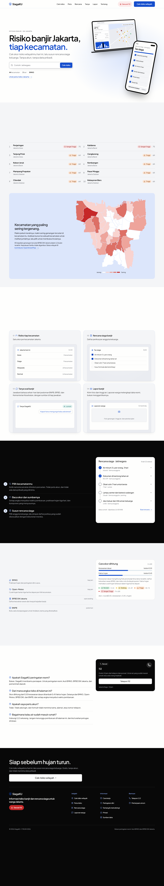
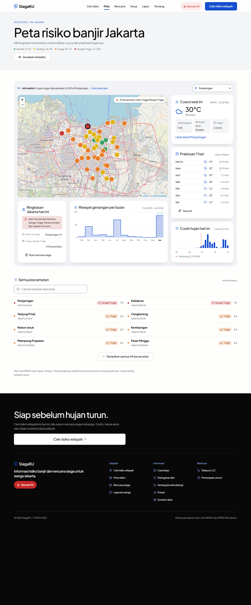
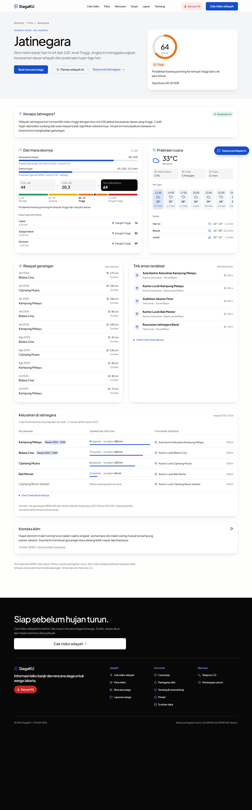
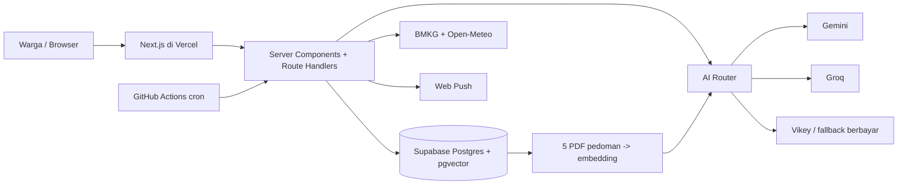

# SiagaKU — Siaga Banjir Jakarta dengan AI

[](https://github.com/Zilfs/SiagaKU/actions/workflows/ci.yml)
[](https://siaga-ku.vercel.app)
[](https://nextjs.org)

**Demo:** https://siaga-ku.vercel.app · **Repo:** https://github.com/Zilfs/SiagaKU · **Video:** _menyusul (YouTube Unlisted)_

## Tentang

Banjir adalah bencana yang paling sering dialami warga Jakarta. Hujan ekstrem dan rob di pesisir utara membuat risikonya terus relevan. SiagaKU membantu warga menjawab tiga pertanyaan praktis: **di mana risikonya hari ini**, **apa yang harus disiapkan keluarga**, dan **apa kata pedoman resmi**.

SiagaKU dibuat untuk **Web Development IT RUSH 2026 (HIMATIF UNIB)** pada subtema **Mitigasi Bencana dan Perubahan Iklim**. AI menjadi bagian inti fitur: penjelasan risiko, chatbot RAG, rencana siaga keluarga, dan pemeriksaan foto laporan banjir.

Tidak ada login, tidak ada kolom nama/alamat/telepon, dan tidak perlu akun demo.

## Fitur

| Fitur                     | Yang bisa dilakukan pengguna                                                                         |
| ------------------------- | ---------------------------------------------------------------------------------------------------- |
| **Cek risiko**            | Pilih kecamatan atau gunakan lokasi untuk melihat level risiko banjir, skor, dan faktor penyusunnya. |
| **Peta & detail wilayah** | Dashboard cuaca-banjir 44 kecamatan, grafik riwayat genangan, dan kartu kelurahan rawan.             |
| **Rencana siaga**         | Wizard 3 langkah menghasilkan rencana keluarga yang bisa dibuka di perangkat lain dan dicetak.       |
| **Tanya SiagaKU**         | Chatbot yang menjawab dari 5 PDF pedoman resmi dengan sitasi dan kartu darurat 112.                  |
| **Peringatan dini**       | Pantau kelurahan, izin Web Push, dan notifikasi otomatis dari cron setiap jam.                       |
| **Lapor banjir**          | Unggah foto, kecamatan terdeteksi dari lokasi, dan AI memeriksa apakah foto benar-benar banjir.      |
| **Tentang**               | Metodologi skor, sumber data, cara kerja AI, privasi, dan kredit terbuka.                            |

### Tampilan

Beranda dan panel cek risiko:



Dashboard peta dan cuaca:



Detail kecamatan dengan ringkasan kelurahan:



## Arsitektur & cara kerja AI



Route handler memvalidasi input dengan zod dan menerapkan rate limit; semua akses Supabase memakai service role di sisi server. Dokumen pedoman di-embedding ke pgvector. Saat ditanya, sistem mengambil 5 potongan dengan kemiripan minimal 0,55; jika gagal, ia turun ke full-text search, lalu ke jawaban tanpa AI.

Router teks mencoba **Gemini -> Groq -> Vikey**. Perpindahan terjadi pada kuota habis (429), galat server, timeout, atau keluaran tidak valid—bukan pada pemblokiran keamanan. Jika semua penyedia gagal, fitur memakai template rule-based. Foto laporan memakai urutan **Groq -> Gemini -> Vikey** agar kuota Gemini tidak cepat habis.

## Tech stack

- **Framework:** Next.js 16 App Router, React 19, TypeScript strict, Tailwind CSS 4, shadcn/ui, Base UI.
- **Data:** Supabase Postgres + pgvector, Zod, server-only service role.
- **Peta & visual:** Leaflet, OpenStreetMap, GSAP, lucide-react, font Plus Jakarta Sans.
- **AI:** Vercel AI SDK dengan adapter Google, Groq, dan adapter AI SDK untuk Vikey; unpdf untuk ekstraksi PDF.
- **Notifikasi:** web-push + VAPID, GitHub Actions cron.
- **Pengujian:** Vitest, ESLint, Prettier, tsx.

## Metodologi skor risiko & sumber data

Skor 0-100 adalah **estimasi kesiapsiagaan**, bukan prediksi:

```
skor = round(0.55 × kerawanan_dasar + 0.45 × faktor_hujan)
```

`kerawanan_dasar` dihitung saat seeding dari frekuensi banjir, kelurahan rawan BPBD, dan status pesisir/rob. `faktor_hujan` berasal dari maksimum curah hujan harian 3 hari ke depan (Open-Meteo) menurut kategori BMKG. Level: 0-24 Rendah, 25-49 Sedang, 50-74 Tinggi, 75-100 Sangat Tinggi.

Sumber: BPBD DKI Jakarta, BMKG, Open-Meteo, BNPB, Kemendikbudristek, dan OpenStreetMap. Rincian baris-per-baris ada di [`data/README.md`](data/README.md) dan di halaman `/tentang`.

## Menjalankan lokal

Prasyarat: Node.js >= 20 dan proyek Supabase.

```bash
npm ci
cp .env.example .env.local
# isi NEXT_PUBLIC_SITE_URL, kredensial Supabase, GEMINI/GROQ,
# IP_SALT, CRON_SECRET, dan opsional ALT_AI_* untuk Vikey serta VAPID
```

Jalankan migrasi `supabase/migrations/0001_init.sql` sampai `0006_reports_naming.sql` lewat SQL Editor Supabase atau MCP. Jangan memakai `supabase db push` karena riwayat migrasi remote memakai versi tanggal.

```bash
npm run db:seed
npm run db:seed-subdistricts
npm run rag:ingest
npm run dev
```

Buka http://localhost:3000. Jika sebagian chunk belum ber-embedding, jalankan `npm run rag:backfill`. Kunci `SUPABASE_SERVICE_ROLE_KEY` hanya boleh dipakai di server dan tidak pernah dikirim ke browser.

## Struktur folder

```
src/
├── app/          # route tipis: halaman (site) dan /api
├── components/   # UI bersama: ui/, layout/, map/, risk-badge
├── lib/          # inti bersama: db, data, risk scoring, ai router, geo
└── features/     # modul: risk, plan, chat, early-warning, report
data/             # CSV kurasi + 5 PDF pedoman RAG
scripts/          # seed, ingest, smoke, eval, health checks
supabase/         # migrasi SQL
docs/             # dokumentasi teknis dan deliverable lomba
```

## Pengujian

```bash
npm run lint
npm run typecheck
npm test
npm run build
SMOKE_BASE_URL=https://siaga-ku.vercel.app npm run smoke
npm run check:bundle
EVAL_BASE_URL=https://siaga-ku.vercel.app npm run eval
```

Saat README ini ditulis, `npm test` lulus 434 tes di 49 berkas dan smoke produksi lulus 47 dari 47 pemeriksaan. Eval live memerlukan kredensial dan belum dijalankan di mesin lokal.

## Penggunaan library, aset, & AI coding assistant

SiagaKU memakai Next.js, React, Tailwind CSS, shadcn/ui, Base UI, lucide-react, GSAP, class-variance-authority, zod, Supabase JS, Leaflet, Vercel AI SDK, unpdf, web-push, Vitest, dan tsx.

Aset: font Plus Jakarta Sans (SIL OFL), taste-skill (MIT), ubin dan batas wilayah OpenStreetMap (ODbL), ilustrasi footer dan ikon dibuat oleh tim, serta 5 PDF pedoman dari BPBD/BNPB/Kemendikbudristek.

AI coding assistant yang dipakai: Claude Code (Anthropic) untuk scaffolding dan implementasi awal, serta opencode/DeepSeek V4.1 Flash untuk router AI, RAG, dan penyempurnaan UI. Rincian lisensi pihak ketiga ada di [`CREDITS.md`](CREDITS.md) dan [`THIRD_PARTY_NOTICES.md`](THIRD_PARTY_NOTICES.md).

## Batasan & disclaimer

SiagaKU hanya mencakup 44 kecamatan DKI Jakarta dan menghasilkan estimasi, bukan peringatan resmi. Data curah hujan bersifat prakiraan dan histori banjir bergantung pada kurasi sumber terbuka. AI dapat keliru; untuk darurat, hubungi **112**. Aplikasi tidak menyimpan identitas pengguna, dan satu-satunya nomor telepon yang boleh muncul dari AI adalah 112.

## Tim

Tim **SDLC** — Web Development IT RUSH 2026:

- Habibi Ghufron Hilmiy — Universitas BSI
- Hirzi Ahnaf Rapiyadi — Universitas Pembangunan Nasional Veteran Jakarta
- Bagus Aliefya Kurniawan — Universitas Gunadarma
- Syakirana Aurieli Pasa — Universitas Gunadarma

## Lisensi

Kode disediakan untuk keperluan kompetisi IT RUSH 2026. Pustaka dan aset pihak ketiga tetap berada di bawah lisensi masing-masing; rinciannya ada di `CREDITS.md` dan `THIRD_PARTY_NOTICES.md`.
