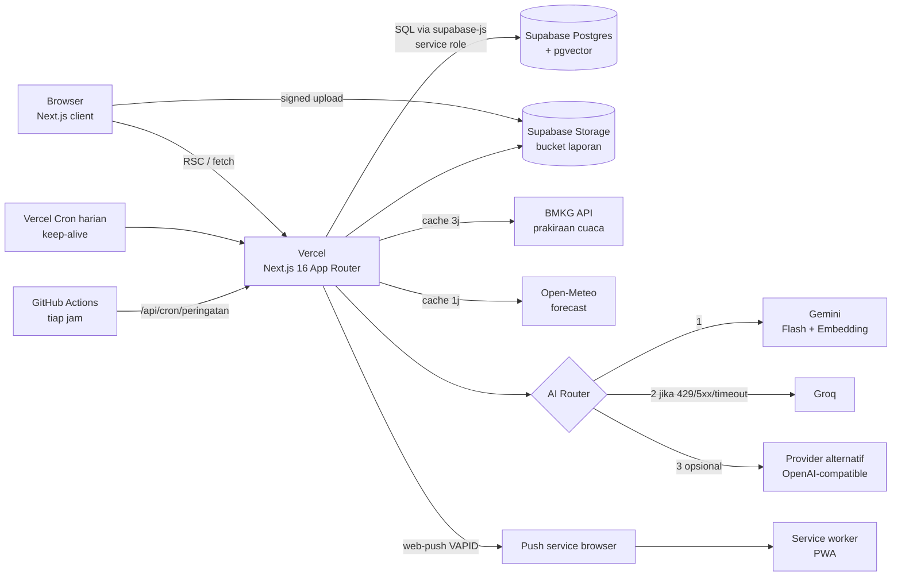
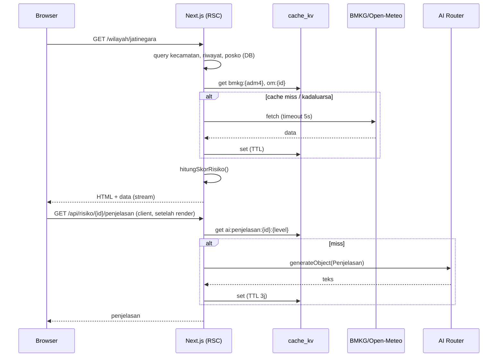

# Arsitektur Sistem

Terkait: [[01 Design Doc]] · [[05 Desain AI]] · [[06 Data & Database]] · [[07 API Spec]]

## 1. Gambaran Besar



## 2. Stack

| Lapisan | Pilihan | Catatan |
|---|---|---|
| Framework | Next.js 16 (App Router), React, TypeScript (strict) | Turbopack default; Node ≥ 20 |
| UI | Tailwind CSS, shadcn/ui, lucide-react | Komponen aksesibel |
| Peta | Leaflet + react-leaflet, tile OpenStreetMap | Di-load dinamis (`ssr:false`) |
| Grafik | Recharts | Kartu iklim, komponen skor |
| Validasi | zod | Input API + output AI |
| AI SDK | Vercel AI SDK (`ai`, `@ai-sdk/google`, `@ai-sdk/groq`, `@ai-sdk/openai-compatible`) | Streaming, `generateObject`, satu interface |
| DB | Supabase Postgres + pgvector + Storage | `@supabase/supabase-js` |
| Markdown | `react-markdown` + `rehype-sanitize` | Render jawaban chat dengan aman |
| Testing | Vitest | Fungsi murni + route handler dengan mock |
| Lint/format | ESLint, Prettier | CI |
| CI | GitHub Actions | lint, typecheck, test pada setiap PR |
| Hosting | Vercel (Hobby) | Preview deploy per PR |
| Script | `tsx` | Seeding & ingest |
| Push | `web-push` (VAPID) | Kirim Web Push dari server |
| PWA | `app/manifest.ts` + `public/sw.js` (ditulis manual, tanpa plugin) | Hanya event `push` & `notificationclick` |
| Cron peringatan | GitHub Actions `schedule: '7 * * * *'` | Memanggil endpoint dengan secret |

> Versi persis library ditentukan saat `create-next-app` (ambil versi stabil terbaru).

## 3. Struktur Folder (saran)

```
siagaku/
├─ src/
│  ├─ app/
│  │  ├─ (site)/
│  │  │  ├─ page.tsx                 # Landing
│  │  │  ├─ peta/page.tsx            # F1 peta
│  │  │  ├─ wilayah/[slug]/page.tsx  # F1 detail
│  │  │  ├─ rencana/page.tsx         # F2 form
│  │  │  ├─ rencana/[slug]/page.tsx  # F2 hasil
│  │  │  ├─ tanya/page.tsx           # F3
│  │  │  ├─ lapor/page.tsx           # F4 form
│  │  │  ├─ laporan/page.tsx         # F4 peta laporan
│  │  │  ├─ tentang/page.tsx         # F6
│  │  │  └─ peringatan/page.tsx      # F8
│  │  ├─ api/
│  │  │  ├─ kecamatan/route.ts
│  │  │  ├─ risiko/[id]/route.ts
│  │  │  ├─ risiko/[id]/penjelasan/route.ts
│  │  │  ├─ rencana/route.ts
│  │  │  ├─ rencana/[slug]/route.ts
│  │  │  ├─ chat/route.ts
│  │  │  ├─ laporan/route.ts
│  │  │  ├─ laporan/upload-url/route.ts
│  │  │  ├─ kelurahan/route.ts
│  │  │  ├─ peringatan/[kode]/route.ts
│  │  │  ├─ push/{subscribe,unsubscribe,test}/route.ts
│  │  │  ├─ cron/peringatan/route.ts
│  │  │  └─ health/route.ts
│  │  ├─ manifest.ts
│  │  ├─ layout.tsx
│  │  └─ globals.css
│  ├─ components/
│  │  ├─ ui/                 # shadcn
│  │  ├─ map/                # RiskMap, ReportLayer
│  │  ├─ risk/               # RiskGauge, ScoreBreakdown, WeatherStrip, FloodHistory
│  │  ├─ plan/               # PlanWizard, PlanView, Checklist
│  │  ├─ chat/               # ChatPanel, ChatWidget, SourceList, EmergencyCard
│  │  ├─ report/             # ReportForm, ReportCard
│  │  └─ layout/             # Header, Footer, EmergencyButton
│  ├─ lib/
│  │  ├─ ai/
│  │  │  ├─ providers.ts     # inisialisasi Gemini, Groq, alternatif dari env
│  │  │  ├─ router.ts        # withFallback(): urutan provider + klasifikasi error
│  │  │  ├─ prompts/         # system prompt per fitur (.ts)
│  │  │  ├─ schemas.ts       # zod: RencanaSiaga, HasilVision, Penjelasan
│  │  │  ├─ embed.ts
│  │  │  └─ rag.ts           # retrieve(): embed → match_chunks → fallback FTS
│  │  ├─ risk/
│  │  │  ├─ score.ts         # hitungSkorRisiko() — fungsi murni
│  │  │  └─ level.ts
│  │  ├─ data/
│  │  │  ├─ bmkg.ts          # fetch + parse + cache
│  │  │  ├─ openmeteo.ts
│  │  │  └─ cache.ts         # getOrSet() di tabel cache_kv
│  │  ├─ safety/
│  │  │  ├─ emergency.ts     # deteksiDarurat() — rule-based
│  │  │  └─ fallback-plan.ts # rencana template tanpa AI
│  │  ├─ db/
│  │  │  ├─ client.ts        # server-only supabase client
│  │  │  └─ queries.ts
│  │  ├─ peringatan/       # evaluate.ts (murni), notify.ts (web-push), run.ts (cron)
│  │  ├─ rate-limit.ts
│  │  └─ env.ts              # validasi env dengan zod
│  └─ types/
├─ public/sw.js, public/icons/  # service worker & ikon PWA
├─ scripts/                  # seed-*.ts, ingest-dokumen.ts
├─ data/                     # CSV kurasi + pedoman + demo
├─ supabase/
│  └─ migrations/            # *.sql (skema dari [[06 Data & Database]])
├─ tests/
├─ .github/workflows/{ci,peringatan}.yml
├─ .env.example
└─ README.md
```

## 4. Variabel Lingkungan

```bash
# .env.example
NEXT_PUBLIC_SITE_URL=https://siagaku.vercel.app
NEXT_PUBLIC_SUPABASE_URL=
NEXT_PUBLIC_SUPABASE_ANON_KEY=        # hanya dipakai utk upload via signed URL
SUPABASE_SERVICE_ROLE_KEY=            # server-only

GEMINI_API_KEY=
GEMINI_MODEL=                         # Flash stabil yg tersedia (cek AI Studio)
GEMINI_EMBED_MODEL=gemini-embedding-001

GROQ_API_KEY=
GROQ_MODEL=                           # model teks (mis. gpt-oss / llama)
GROQ_VISION_MODEL=                    # opsional, model multimodal jika tersedia

ALT_AI_BASE_URL=                      # opsional, provider OpenAI-compatible
ALT_AI_API_KEY=
ALT_AI_MODEL=

IP_SALT=                              # random string
CRON_SECRET=                          # proteksi endpoint cron (juga di GitHub Secrets)
NEXT_PUBLIC_VAPID_PUBLIC_KEY=          # npx web-push generate-vapid-keys
VAPID_PRIVATE_KEY=
VAPID_SUBJECT=mailto:tim.siagaku@example.com
AI_TIMEOUT_MS=20000
```

`src/lib/env.ts` memvalidasi env saat startup. Provider yang kosong dilewati oleh router.

## 5. Alur Request Utama

### 5.1 Halaman wilayah


Penjelasan AI dimuat **setelah** halaman tampil, supaya AI yang lambat tidak menahan render.

### 5.2 Chat (RAG)
Lihat [[05 Desain AI#3. F3 Tanya SiagaKU (RAG)]].

## 6. Strategi Cache

| Key | Isi | TTL |
|---|---|---|
| `bmkg:{adm4}` | Respons BMKG yang sudah diparse | 3 jam |
| `om:fc:{kecamatanId}` | Precip 3 hari | 1 jam |
| `ai:penjelasan:{id}:{level}:{hujanBucket}` | Penjelasan AI | 3 jam |
| `ai:chat:{hash(pertanyaan_normal)}` | Jawaban + sumber, hanya untuk pertanyaan tanpa riwayat & tanpa konteks wilayah | 24 jam |

`cache.ts` menyediakan `getOrSet(key, ttl, fn)`. Jika `fn` gagal dan ada nilai kadaluarsa, kembalikan nilai lama + flag `stale: true`.

Tambahan: route data memakai Next.js `revalidate` untuk halaman (ISR 15 menit) bila memungkinkan.

## 7. Keamanan

- Semua akses DB dari server (route handler/RSC) dengan service role; RLS ON + tanpa policy publik (deny by default), kecuali `storage.objects` bucket `laporan` public read.
- Endpoint mutasi (`/api/rencana`, `/api/chat`, `/api/laporan`) memakai rate limit per `ip_hash` + bucket.
- Cron: `/api/health?cron=1` memeriksa header `Authorization: Bearer ${CRON_SECRET}`.
- Output AI dirender sebagai markdown yang disanitasi; tidak pernah `dangerouslySetInnerHTML`.
- Secret tidak pernah di-commit. `.env*` ada di `.gitignore`. Jika terlanjur ter-commit, **rotasi key** (jangan rewrite history, karena dilarang aturan lomba).

## 8. Deploy

1. Buat project Supabase (region terdekat, mis. Singapore) → jalankan migration SQL → buat bucket `laporan`.
2. Jalankan script seed lokal dengan env produksi.
3. Import repo ke Vercel → isi env → deploy.
4. Atur `vercel.json` cron harian ke `/api/health` (keep-alive) dan workflow GitHub Actions `peringatan.yml` tiap jam ke `/api/cron/peringatan` (secret `CRON_SECRET`, `SITE_URL` di GitHub Secrets).
5. Uji smoke test di URL produksi (lihat [[10 Deliverables Lomba#Checklist uji sebelum submit]]).
