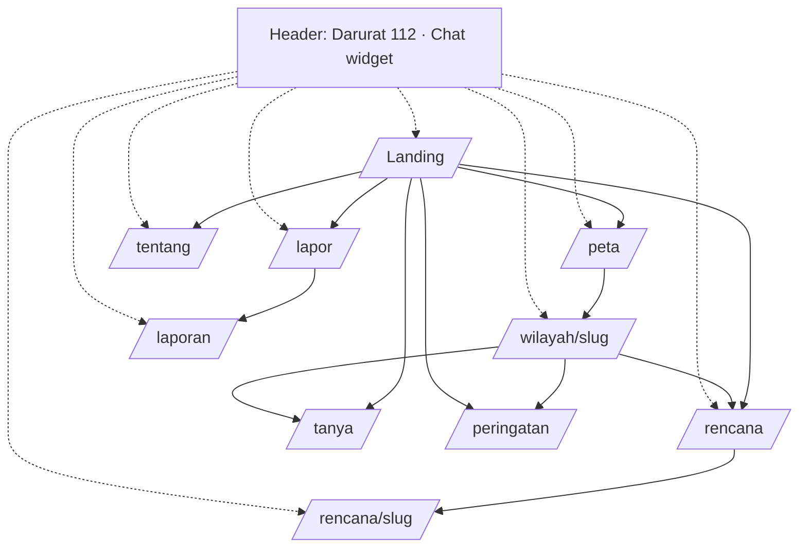
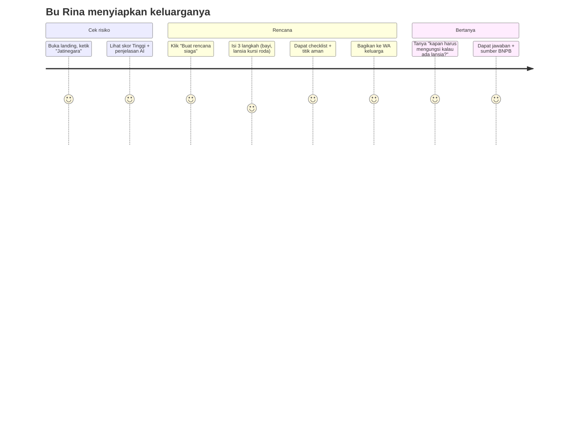
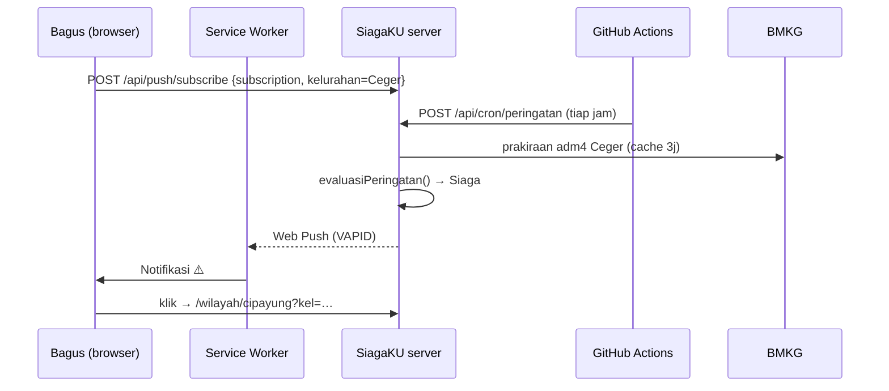

# Fitur & Alur Pengguna

Terkait: [[02 PRD]] · [[08 UI-UX]] · [[07 API Spec]]

## 1. Peta Halaman (Sitemap)

| Halaman | Tujuan | Fitur |
|---|---|---|
| `/` | Menjelaskan nilai SiagaKU dan mengarahkan ke tindakan | Hero + pencarian kecamatan, 3 kartu fitur, ringkasan "risiko Jakarta hari ini" (jumlah kecamatan per level) |
| `/peta` | Melihat risiko seluruh Jakarta | F1 |
| `/wilayah/[slug]` | Detail risiko satu kecamatan | F1, F5 |
| `/rencana` | Membuat rencana siaga | F2 |
| `/rencana/[slug]` | Melihat, mencentang, membagikan, mencetak rencana | F2 |
| `/tanya` | Chat penuh | F3 |
| `/lapor` | Melaporkan genangan | F4 |
| `/laporan` | Peta laporan warga | F4 |
| `/tentang` | Metodologi, sumber, penggunaan AI, tim | F6 |
| `/peringatan` | Pilih kelurahan pantauan, aktifkan/uji/hentikan notifikasi, lihat status | F8 |

## 2. Alur Utama ("Golden Path" untuk demo & juri)

Target: seluruh golden path selesai **< 3 menit** dan bebas error. Skenario ini menjadi naskah utama video demo ([[10 Deliverables Lomba#Naskah video demo]]).

## 3. Alur per Fitur

### F1 — Cek Risiko
1. Pengguna di `/` mengetik nama kecamatan → autocomplete (data `/api/kecamatan`, filter di klien) → klik → `/wilayah/[slug]`.
   - Alternatif: klik "Lihat peta" → `/peta` → klik marker → popup (nama, level, skor) → "Lihat detail".
   - Alternatif: "Gunakan lokasiku" → izin lokasi → kecamatan dengan centroid terdekat → `/wilayah/[slug]`.
2. Halaman wilayah tampil (RSC). Kartu penjelasan AI menampilkan skeleton lalu terisi.
3. CTA: "Buat rencana siaga untuk Jatinegara" → `/rencana?kecamatan=jatinegara`; "Tanya SiagaKU" → buka widget chat dengan konteks wilayah.

**Edge case**
| Kasus | Perilaku |
|---|---|
| Slug tidak ditemukan | Halaman 404 ramah + pencarian |
| BMKG gagal & tanpa cache | Kartu cuaca: "Data BMKG sedang tidak tersedia" + tautan ke cuaca.bmkg.go.id; skor memakai Open-Meteo |
| Open-Meteo gagal & tanpa cache | Skor = kerawanan dasar saja, badge "tanpa data hujan" |
| Lokasi di luar Jakarta | "SiagaKU saat ini hanya untuk DKI Jakarta" + pencarian |
| AI penjelasan gagal | Template per level (tanpa pesan error) |

### F2 — Rencana Siaga
1. `/rencana` → **Langkah 1 Wilayah & Hunian** (kecamatan pra-isi dari query param; jenis hunian berupa kartu pilihan bergambar; lantai).
2. **Langkah 2 Anggota Keluarga** (stepper +/- per kelompok; toggle disabilitas → pilih jenis; obat rutin; hewan berupa chip).
3. **Langkah 3 Kondisi** (kendaraan, jarak sungai, pernah banjir) → ringkasan isian → "Buat Rencana".
4. Loading bertahap (lihat PRD F2.7), lalu redirect ke `/rencana/[slug]`.
5. Halaman hasil, dengan urutan bagian:
   - Header: kecamatan, level risiko, tanggal dibuat, badge "Dibuat dengan AI" atau "Rencana dasar"
   - Ringkasan
   - Tas Siaga (checklist dengan filter "Wajib / Semua", progress bar "8/20 siap")
   - Tab Sebelum / Saat / Setelah
   - Catatan Kelompok Rentan
   - Titik Aman (mini-map + daftar, badge "Terverifikasi" / "Perkiraan")
   - Kontak Darurat (tap-to-call)
   - Aksi: Salin link · Bagikan WA · Cetak / PDF · Buat ulang

**Validasi form:** total anggota ≥ 1; jika `disabilitas` dicentang, minimal 1 jenis dipilih. Tombol Lanjut nonaktif sampai valid. Pesan error di bawah field.

**Edge case**
| Kasus | Perilaku |
|---|---|
| Rate limited | Toast: "Kamu sudah membuat beberapa rencana. Coba lagi dalam beberapa menit." |
| Semua AI gagal | Rencana dasar rule-based tetap dibuat dan disimpan |
| Slug tidak ada | 404 + CTA buat rencana baru |
| Membuka link di perangkat lain | Checklist mulai kosong (state lokal), rencana tetap tampil |

### F3 — Tanya SiagaKU
1. Klik tombol chat (pojok kanan bawah) atau `/tanya`.
2. Layar kosong: salam singkat + 4 chip saran + disclaimer privasi.
3. Kirim pesan → bubble user → indikator "SiagaKU sedang mencari di pedoman…" → (jika darurat: kartu merah 112 di atas) → jawaban streaming → daftar sumber yang bisa dibuka (judul, penerbit, halaman, link).
4. Tombol 👍/👎 per jawaban (disimpan di `ai_log` sebagai feedback, opsional).

**Edge case:** input kosong/terlalu panjang (counter 1000), rate limit, stream putus ("Jawaban terputus. Coba lagi"), di luar topik (penolakan sopan).

### F4 — Lapor Banjir
1. `/lapor` → ambil/unggah foto (input `accept="image/*" capture="environment"`) → preview → kompres di klien (canvas ke webp/jpeg, ≤ 1600 px) + hapus EXIF.
2. Lokasi: tombol "Pakai lokasi saat ini" atau seret pin di mini-map.
3. Deskripsi opsional → Kirim.
4. Progres: "Mengunggah foto…" → "AI menganalisis foto…" → kartu hasil (keparahan, estimasi tinggi air, ringkasan) + "Lihat di peta laporan".
5. Jika ditolak: "Foto ini sepertinya bukan genangan/banjir. Laporan tidak ditampilkan." + coba lagi.

### F8 — Peringatan Dini (contoh: Bagus di Ceger)
1. Bagus membuka `/wilayah/cipayung` → klik **"🔔 Pantau wilayah ini"** → `/peringatan?kecamatan=cipayung`.
2. Pilih kelurahan **Ceger** (autocomplete, atau "Gunakan lokasiku" → kelurahan terdekat).
3. Status saat ini tampil (mis. "Normal · tidak ada hujan berarti 24 jam ke depan"). Kelurahan disimpan di `localStorage` → **banner aktif** di semua halaman.
4. Klik **"Aktifkan notifikasi"** → dialog izin browser → izinkan → subscription tersimpan → toast "Peringatan aktif untuk Ceger".
5. Klik **"Kirim notifikasi uji"** → notifikasi contoh muncul ≤ 10 detik.
6. Saat cron menemukan status **Siaga/Awas** untuk Ceger → notifikasi: "⚠️ Potensi banjir di Ceger, Hujan lebat diperkirakan 15.00–18.00 WIB…" → klik → halaman wilayah dengan banner + CTA rencana siaga & tanya.
7. "Berhenti memantau" → unsubscribe + hapus localStorage.

**Edge case**
| Kasus | Perilaku |
|---|---|
| Browser tidak mendukung push (iPhone non-PWA, browser lama) | Tombol notifikasi diganti panduan "Tambahkan ke Layar Utama" (iOS) / pesan tidak didukung; banner tetap jalan |
| Izin ditolak | Pesan cara mengaktifkan izin di pengaturan situs; banner tetap jalan |
| BMKG gagal saat cron | Pakai cache; jika tidak ada, lewati kelurahan itu (tanpa push), status lama tetap |
| Ganti kelurahan | Subscription di-update (satu perangkat = satu kelurahan) |
| Lokasi di luar Jakarta | "SiagaKU saat ini hanya untuk DKI Jakarta" |

## 4. Komponen Global
- **Header:** logo SiagaKU, navigasi (Peta, Rencana, Tanya, Peringatan, Lapor), tombol **Darurat** merah.
- **Banner peringatan** (di bawah header) jika kelurahan pantauan berstatus Siaga/Awas; bisa ditutup untuk 3 jam.
- **Modal Darurat:** 112 tap-to-call, kontak lain, 5 langkah keselamatan statis, sumber.
- **Footer:** "Estimasi risiko untuk kesiapsiagaan, bukan prediksi resmi. Ikuti arahan BMKG & BPBD DKI." · tautan Tentang · GitHub · data sumber.
- **Chat widget** mengambang (kecuali di `/tanya`).

## 5. State Kosong, Loading, Error

| Komponen | Loading | Kosong | Error |
|---|---|---|---|
| Peta | Skeleton abu + spinner | — | "Peta gagal dimuat" + daftar kecamatan (fallback list) |
| Kartu cuaca | Skeleton 8 slot | — | Pesan + link BMKG |
| Riwayat banjir | Skeleton | "Belum ada catatan banjir di data kami" | Disembunyikan |
| Penjelasan AI | Skeleton 3 baris | — | Template (tanpa error) |
| Chat | Titik-titik animasi | Chip saran | Pesan inline + coba lagi |
| Laporan | Skeleton marker | "Belum ada laporan 72 jam terakhir" + laporan contoh | Pesan + coba lagi |
