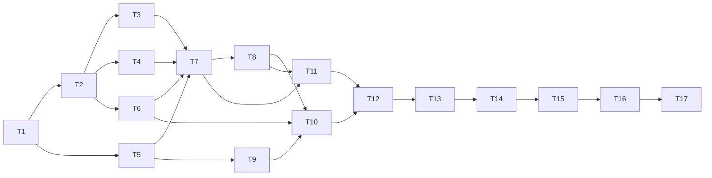

# SiagaKU Implementation Plan

> **For agentic workers (opsional):** bisa dieksekusi dengan superpowers:subagent-driven-development atau superpowers:executing-plans; tanpa skill, kerjakan task per task secara manual. Steps use checkbox (`- [ ]`) syntax for tracking.
> Satu-satunya salinan plan di repo adalah `docs/13 Implementation Plan.md`; aturan kerja tim ada di `AGENTS.md`.

**Goal:** Membangun SiagaKU, web app kesiapsiagaan banjir DKI Jakarta (cek risiko, rencana siaga AI, chatbot RAG, peringatan dini push per kelurahan, lapor banjir), live di Vercel sebelum 20 Nov 2026.

**Architecture:** Monolit Next.js 16 App Router (TypeScript) di Vercel. Data dan pgvector di Supabase, diakses hanya dari server. Semua panggilan AI lewat satu router fallback (Gemini → Groq → alternatif) di atas Vercel AI SDK. Setiap fitur AI punya fallback non-AI.

**Tech Stack:** Next.js 16, React, TypeScript strict, Tailwind + shadcn/ui, react-leaflet, Recharts, zod, Vercel AI SDK (`ai`, `@ai-sdk/google`, `@ai-sdk/groq`, `@ai-sdk/openai-compatible`), `@supabase/supabase-js`, Vitest, `tsx`, GitHub Actions.

**Spec:** [[01 Design Doc]] + [[02 PRD]] (detail: [[03 Arsitektur Sistem]], [[05 Desain AI]], [[06 Data & Database]], [[07 API Spec]], [[04 Fitur & Alur Pengguna]], [[08 UI-UX]]).

## Global Constraints
- Next.js 16 App Router + TypeScript `strict: true`; Node ≥ 20.
- Semua akses Supabase **server-side** dengan service role; RLS ON di semua tabel; browser hanya upload lewat signed URL.
- Model id AI **selalu dari env** (`GEMINI_MODEL`, `GROQ_MODEL`, `GROQ_VISION_MODEL`, `ALT_AI_MODEL`, `GEMINI_EMBED_MODEL=gemini-embedding-001`); embedding 768 dimensi.
- Urutan provider: `gemini` → `groq` → `alt`. Pindah saat 429/5xx/timeout/output invalid; **tidak** pindah saat safety block.
- Skor: `round(0.55 × kerawanan_dasar + 0.45 × faktor_hujan)`; level 0–24 Rendah, 25–49 Sedang, 50–74 Tinggi, 75–100 Sangat Tinggi.
- Titik aman & kontak darurat **hanya dari DB**; nomor darurat yang boleh muncul dari AI hanya `112`.
- UI berbahasa Indonesia; level risiko = warna + label + ikon.
- Copy wajib: disclaimer "Skor ini adalah estimasi untuk kesiapsiagaan, bukan peringatan resmi. Ikuti informasi BMKG dan BPBD DKI Jakarta."
- Tidak ada login. Tidak ada field nama/alamat/HP di form mana pun.
- Jangan pernah `git push --force` / rewrite history di `main`. Secret tidak boleh di-commit.
- Setiap library/aset/AI coding assistant dicatat di `CREDITS.md` sejak task pertama.
- Peringatan Dini: status `Normal|Waspada|Siaga|Awas`; push hanya Siaga/Awas; dedupe 6 jam kecuali status naik; teks notifikasi template, **tanpa AI**; disclaimer "Ini potensi, bukan kepastian. Peringatan resmi tetap dari BMKG dan BPBD DKI Jakarta."
- Format error API: `{ "error": { "code": "...", "message": "..." } }` dengan code `INVALID_INPUT|NOT_FOUND|RATE_LIMITED|UPSTREAM_FAILED|INTERNAL`.

## Review Focus
1. **Lokasi di luar Jakarta / koordinat jauh** → "Gunakan lokasiku" dan laporan tidak boleh memetakan ke kecamatan terdekat sembarangan. Lebih dari 15 km dari centroid mana pun berarti `null` + pesan "hanya untuk DKI Jakarta" (test di Task 4).
2. **Respons BMKG/Open-Meteo bentuk tak terduga atau nilai `null`** → parser tidak melempar error; slot kosong, `maxMm=null`, skor memakai kerawanan saja dengan badge "tanpa data hujan" (test di Task 3 & 2).
3. **AI mengembalikan `titik_aman_ids` asing/kosong** → ID asing dibuang; jika kosong dipakai 2 titik pertama (test di Task 11).
4. **Input chat ekstrem** (array kosong, >10 pesan, konten >1000 karakter, role aneh) → 400 `INVALID_INPUT`, tidak memanggil AI (test di Task 10).
5. **Semua provider AI gagal** → penjelasan memakai template, rencana memakai rencana dasar, chat mengembalikan pesan ramah; halaman tidak crash (test di Task 5, 7, 11).

---

## Peta File

> [!warning] Path di tabel ini sudah digantikan struktur feature-based. Terjemahkan ke path baru dengan [[14 Struktur Kode#6. Pemetaan path Plan → struktur baru]].

| File | Tanggung jawab | Task |
|---|---|---|
| `src/lib/env.ts` | Validasi env (zod) | 1 |
| `supabase/migrations/0001_init.sql` | Skema + RPC dari [[06 Data & Database]] | 2 |
| `src/lib/db/client.ts` | `supabaseServer()` server-only | 2 |
| `src/lib/data/cache.ts` | `getOrSet` + store Supabase | 2 |
| `src/lib/risk/level.ts`, `score.ts`, `kerawanan.ts` | Fungsi murni skor | 3 |
| `src/lib/data/bmkg.ts`, `openmeteo.ts` | Fetch + parse + cache | 3 |
| `src/lib/geo.ts` | `jarakKm`, `kecamatanTerdekat` | 4 |
| `scripts/seed-*.ts`, `data/*.csv` | Seeding | 4 |
| `src/lib/ai/providers.ts`, `router.ts`, `log.ts` | Router fallback | 5 |
| `src/lib/rate-limit.ts`, `src/lib/http.ts` | Rate limit, IP hash, helper error | 6 |
| `src/lib/risk/service.ts`, `src/lib/ai/penjelasan.ts`, `app/api/kecamatan`, `app/api/risiko/*` | API risiko | 7 |
| `app/(site)/layout`, landing, peta, wilayah, `components/*` | UI F1, F7 | 8 |
| `src/lib/rag/chunk.ts`, `embed.ts`, `retrieve.ts`, `scripts/ingest-dokumen.ts` | RAG | 9 |
| `src/lib/safety/emergency.ts`, `app/api/chat`, `components/chat/*`, `app/(site)/tanya` | F3 | 10 |
| `src/lib/rencana/*`, `app/api/rencana/*`, `app/(site)/rencana/*` | F2 | 11 |
| `app/api/health`, `vercel.json`, `app/(site)/tentang` | Ops + F6 | 12 |
| `scripts/eval.ts`, `tests/eval/*.json` | Eval AI | 13 |
| `src/lib/peringatan/*`, `app/api/{kelurahan,peringatan,push,cron}/*`, `app/(site)/peringatan`, `app/manifest.ts`, `public/sw.js`, `.github/workflows/peringatan.yml` | F8 (Should) | 14 |
| `src/lib/laporan/*`, `app/api/laporan/*`, `app/(site)/lapor`, `laporan` | F4 (Could) | 15 |
| `components/risk/ClimateCard.tsx` (statis) | F5 (dipotong) | 16 |
| `README.md`, `CREDITS.md`, smoke | Rilis | 17 |

---

### Task 1: Scaffold, tooling, CI, env

**Files:**
- Create: project via `create-next-app`, `src/lib/env.ts`, `.env.example`, `vitest.config.ts`, `.github/workflows/ci.yml`, `CREDITS.md`, `.prettierrc`
- Test: `tests/lib/env.test.ts`

**Interfaces:**
- Produces: `parseEnv(raw: Record<string, string | undefined>): Env`, `env: Env` (lazy getter). `Env` berisi semua key di [[03 Arsitektur Sistem#4. Variabel Lingkungan]]; provider opsional bertipe `string | undefined`; `AI_TIMEOUT_MS: number` default 20000.

- [ ] **Step 1:** `npx create-next-app@latest siagaku --ts --tailwind --eslint --app --src-dir --import-alias "@/*"`; `npx shadcn@latest init`; pasang `zod vitest @vitejs/plugin-react prettier tsx`. Set `"strict": true`. Script `package.json`: `test`, `typecheck` (`tsc --noEmit`), `lint`, `format`.
- [ ] **Step 2: Write the failing test** `tests/lib/env.test.ts`
```ts
it('menolak env tanpa SUPABASE_SERVICE_ROLE_KEY', () => {
  expect(() => parseEnv({ NEXT_PUBLIC_SUPABASE_URL: 'https://x.supabase.co' })).toThrow(/SUPABASE_SERVICE_ROLE_KEY/);
});
it('provider opsional boleh kosong & timeout default 20000', () => {
  const e = parseEnv(minimalValidEnv); // helper berisi key wajib saja
  expect(e.GROQ_API_KEY).toBeUndefined();
  expect(e.AI_TIMEOUT_MS).toBe(20000);
});
it('mewajibkan minimal satu provider LLM', () => {
  expect(() => parseEnv({ ...minimalValidEnv, GEMINI_API_KEY: undefined })).toThrow(/provider/i);
});
```
Wajib: `NEXT_PUBLIC_SUPABASE_URL`, `SUPABASE_SERVICE_ROLE_KEY`, `IP_SALT`, `CRON_SECRET`, dan minimal satu pasangan `GEMINI_API_KEY+GEMINI_MODEL` atau `GROQ_API_KEY+GROQ_MODEL`.
- [ ] **Step 3:** Run `npm test -- env` → FAIL.
- [ ] **Step 4:** Implement `parseEnv` dengan zod + `superRefine` untuk aturan provider.
- [ ] **Step 5:** Run `npm test -- env` → PASS.
- [ ] **Step 6:** CI `ci.yml`: on push/PR → `npm ci && npm run lint && npm run typecheck && npm test`.
- [ ] **Step 7:** Push repo **publik** ke GitHub, import ke Vercel, isi env, deploy → halaman default terbuka di URL produksi.
- [ ] **Step 8: Commit** `chore: scaffold next.js, tooling, ci, env validation`

---

### Task 2: Skema database, client, cache

**Files:**
- Create: `supabase/migrations/0001_init.sql` (salin skema + `match_chunks` + `search_chunks_fts` dari [[06 Data & Database#3. Skema Database (Supabase Postgres)]], plus `alter table … enable row level security` untuk semua tabel), `src/lib/db/client.ts`, `src/lib/data/cache.ts`
- Test: `tests/lib/cache.test.ts`

**Interfaces:**
- Produces:
  - `supabaseServer(): SupabaseClient` (file diawali `import 'server-only'`)
  - `interface CacheStore { get(key: string): Promise<{ value: unknown; expiresAt: Date } | null>; set(key: string, value: unknown, expiresAt: Date): Promise<void> }`
  - `memoryCacheStore(): CacheStore`, `supabaseCacheStore(): CacheStore` (tabel `cache_kv`)
  - `getOrSet<T>(key: string, ttlSeconds: number, fn: () => Promise<T>, store?: CacheStore, now?: () => Date): Promise<{ value: T; stale: boolean }>`

- [ ] **Step 1: Failing tests**
```ts
it('cache hit tidak memanggil fn', ...)                       // fn dipanggil 0x, stale=false
it('cache kadaluarsa memanggil fn dan menyimpan ulang', ...)   // fn 1x
it('fn gagal + ada nilai kadaluarsa → kembalikan nilai lama, stale=true', ...)
it('fn gagal + tanpa nilai → melempar error asli', ...)
```
- [ ] **Step 2:** Run `npm test -- cache` → FAIL.
- [ ] **Step 3:** Implement `getOrSet` (default store = `supabaseCacheStore()`), `memoryCacheStore`, `supabaseCacheStore` (upsert `cache_kv`).
- [ ] **Step 4:** Run → PASS.
- [ ] **Step 5:** Jalankan migrasi di Supabase (SQL editor atau `supabase db push`); buat bucket `laporan` (public read). Verifikasi: `select cfgname from pg_ts_config` (jika `indonesian` tidak ada, ganti ke `simple` di migrasi).
- [ ] **Step 6: Commit** `feat(db): schema, rls, server client, cache`

---

### Task 3: Skor risiko & data cuaca

**Files:**
- Create: `src/lib/risk/level.ts`, `src/lib/risk/score.ts`, `src/lib/risk/kerawanan.ts`, `src/lib/data/bmkg.ts`, `src/lib/data/openmeteo.ts`, `tests/fixtures/bmkg-gambir.json` (respons nyata `adm4=31.71.01.1001`), `tests/fixtures/openmeteo-forecast.json`
- Test: `tests/lib/risk.test.ts`, `tests/lib/weather.test.ts`

**Interfaces:**
- Produces:
  - `type Level = 'Rendah' | 'Sedang' | 'Tinggi' | 'Sangat Tinggi'`; `levelDariSkor(skor: number): Level`
  - `type KategoriHujan = 'Tidak/sangat ringan' | 'Ringan' | 'Sedang' | 'Lebat' | 'Sangat lebat' | 'Ekstrem'`
  - `kategoriHujan(mm: number): { kategori: KategoriHujan; faktor: number }`
  - `hitungSkorRisiko(i: { kerawananDasar: number; maxHujanMm: number | null }): { skor: number; level: Level; faktorHujan: number; kategoriHujan: KategoriHujan | null; tanpaDataHujan: boolean }`
  - `hitungKerawananDasar(i: { jumlahKejadian5Th: number; kelurahanRawan: number; totalKelurahan: number; pesisirRob: boolean }): number`
  - `type SlotCuaca = { waktuLokal: string; suhu: number | null; kelembapan: number | null; cuaca: string; ikon: string | null; hujanMm: number | null }`
  - `parseBmkg(json: unknown): { diperbarui: string | null; slot: SlotCuaca[] }`; `getCuacaBmkg(adm4: string): Promise<{ data: ReturnType<typeof parseBmkg> | null; stale: boolean }>` (cache `bmkg:{adm4}` 10800 s, timeout 5 s)
  - `parseMaxHujan(json: unknown): number | null`; `getMaxHujan3Hari(kecamatanId: number, lat: number, lng: number): Promise<{ maxMm: number | null; stale: boolean }>` (cache `om:fc:{id}` 3600 s)

- [ ] **Step 1: Failing tests** `risk.test.ts`
```ts
test.each([[0,'Rendah'],[24,'Rendah'],[25,'Sedang'],[49,'Sedang'],[50,'Tinggi'],[74,'Tinggi'],[75,'Sangat Tinggi'],[100,'Sangat Tinggi']])('levelDariSkor(%i)=%s', ...)
test.each([[0,0],[4.9,0],[5,20],[19.9,20],[20,45],[50,70],[100,90],[150.1,100]])('faktor hujan %f mm → %i', ...)
it('skor = round(0.55*80 + 0.45*70) = 76', () => expect(hitungSkorRisiko({ kerawananDasar: 80, maxHujanMm: 62 }).skor).toBe(76));
it('maxHujanMm null → faktor 0, tanpaDataHujan true', ...)
it('kerawanan: 3 kejadian, 2/7 kelurahan rawan, pesisir → min(100, 30 + max(10, round(30*2/7)) + 20) = 60', ...)
it('kerawanan dibatasi 100 dan kejadian dibatasi 50', ...)
```
Batas kategori: `<5`→0, `5–<20`→20, `20–<50`→45, `50–<100`→70, `100–≤150`→90, `>150`→100.
- [ ] **Step 2: Failing tests** `weather.test.ts`: `parseBmkg(fixture)` menghasilkan ≥ 8 slot dengan `suhu` number; `parseBmkg({})` → `{ diperbarui: null, slot: [] }` tanpa throw; `parseMaxHujan` mengambil max dari `daily.precipitation_sum`, mengabaikan `null`, mengembalikan `null` jika semua null/field hilang.
- [ ] **Step 3:** Run `npm test -- risk weather` → FAIL.
- [ ] **Step 4:** Implement. BMKG: struktur `data[0].cuaca` adalah array per hari berisi slot (field `local_datetime`, `t`, `hu`, `weather_desc`, `image`, `tp`); cek terhadap fixture. Open-Meteo URL: `https://api.open-meteo.com/v1/forecast?latitude=…&longitude=…&daily=precipitation_sum&timezone=Asia%2FJakarta&forecast_days=3`.
- [ ] **Step 5:** Run → PASS.
- [ ] **Step 6: Commit** `feat(risk): scoring functions, bmkg & open-meteo clients`

---

### Task 4: Data kurasi & seeding (paralel dengan Task 3–5, jalur W4 + W2)

**Files:**
- Create: `data/kecamatan.csv`, `data/riwayat_banjir.csv`, `data/kelurahan_rawan.csv`, `data/posko.csv`, `data/kontak.csv` (format di [[06 Data & Database#5. Seeding]]), `src/lib/geo.ts`, `scripts/lib/csv.ts`, `scripts/seed-kecamatan.ts`, `scripts/seed-banjir.ts`, `scripts/seed-posko.ts`
- Test: `tests/lib/geo.test.ts`, `tests/scripts/csv.test.ts`

**Interfaces:**
- Consumes: `hitungKerawananDasar` (Task 3), `supabaseServer` (Task 2)
- Produces: `jarakKm(a: {lat:number;lng:number}, b: {lat:number;lng:number}): number`; `kecamatanTerdekat<T extends {lat:number;lng:number}>(titik: {lat:number;lng:number}, daftar: T[], maxKm = 15): T | null`; tabel `kecamatan` terisi 44 baris dengan `kerawanan_dasar`.

- [ ] **Step 1: Failing tests** `geo.test.ts`: jarak Monas (-6.1754, 106.8272) ke Bundaran HI (-6.1950, 106.8230) ≈ 2.2 km (±0.2); `kecamatanTerdekat` memilih centroid terdekat; titik Bandung (-6.9175, 107.6191) → `null`.
- [ ] **Step 2: Failing test** `csv.test.ts`: `parseCsv` menangani koma di dalam tanda kutip dan baris kosong; validasi zod per file menolak `sumber_url` kosong di `riwayat_banjir`.
- [ ] **Step 3:** Run → FAIL. **Step 4:** Implement (haversine; parser CSV kecil atau `csv-parse`). **Step 5:** Run → PASS.
- [ ] **Step 6:** W4 mengisi `kecamatan.csv` (44 baris: `slug,nama,kota,kode_wilayah,adm4_bmkg,lat,lng,pesisir_rob`). `adm4_bmkg` = kode kelurahan pusat kecamatan; uji 3 kode acak ke API BMKG.
- [ ] **Step 7:** Seed: `npx tsx scripts/seed-kecamatan.ts && npx tsx scripts/seed-banjir.ts && npx tsx scripts/seed-posko.ts`. Script banjir menghitung `kerawanan_dasar` (kejadian 5 tahun dari `tanggal >= now()-5y`) lalu update `kecamatan`. Verifikasi: `select count(*) from kecamatan` = 44; Jatinegara/Cengkareng/Kalideres punya kerawanan ≥ 40.
- [ ] **Step 8: Commit** `feat(data): curated csv, geo utils, seed scripts` (CSV boleh di-commit bertahap)

---

### Task 5: AI providers & router fallback

**Files:**
- Create: `src/lib/ai/providers.ts`, `src/lib/ai/router.ts`, `src/lib/ai/log.ts`
- Test: `tests/lib/ai-router.test.ts`

**Interfaces:**
- Consumes: `env` (Task 1)
- Produces:
  - `type ProviderName = 'gemini' | 'groq' | 'alt'`; `type AiTask = 'penjelasan' | 'rencana' | 'chat' | 'vision' | 'iklim'`
  - `type ProviderEntry = { name: ProviderName; modelId: string; model: LanguageModel; timeoutMs: number }`
  - `getProviderChain(task: AiTask): ProviderEntry[]` (lewati provider tanpa env, provider dalam cooldown, dan provider tanpa model vision untuk `vision`; chat `timeoutMs` = 8000)
  - `type ErrorKind = 'quota' | 'server' | 'timeout' | 'invalid' | 'safety' | 'unknown'`; `classifyError(err: unknown): ErrorKind`
  - `withFallback<T>(task: AiTask, run: (p: ProviderEntry) => Promise<T>, opts?: { chain?: ProviderEntry[]; log?: (e: AiLogEntry) => Promise<void> }): Promise<{ result: T; provider: ProviderName; modelId: string; fallback: boolean }>`
  - `class AllProvidersFailed extends Error { causes: ErrorKind[] }`
  - `markCooldown(name: ProviderName, ms: number): void`; `logAi(e: AiLogEntry): Promise<void>` (insert `ai_log`, tidak pernah melempar)

- [ ] **Step 1: Failing tests** (chain palsu berisi 3 entry, `run` dikontrol test):
```ts
it('sukses di provider pertama → fallback=false', ...)
it('429 di gemini → pindah ke groq, fallback=true, gemini masuk cooldown', ...)
it('5xx → retry 1x di provider sama, lalu pindah', ...)        // run dipanggil 2x untuk gemini
it('timeout (run > timeoutMs) → pindah', ...)                   // pakai fake timers
it('ZodError → kind invalid → pindah', ...)
it('safety block → melempar langsung tanpa mencoba groq', ...)
it('semua gagal → AllProvidersFailed dengan causes [quota, server, timeout]', ...)
it('log dipanggil untuk tiap percobaan dengan status ok/error', ...)
```
`classifyError`: status 429 atau pesan berisi `RESOURCE_EXHAUSTED`/`rate limit` → quota; status ≥ 500 / `ECONNRESET` → server; `AbortError`/`TimeoutError` → timeout; `ZodError`/`NoObjectGeneratedError` → invalid; `finishReason === 'content-filter'` atau `SAFETY` → safety.
- [ ] **Step 2:** Run `npm test -- ai-router` → FAIL.
- [ ] **Step 3:** Implement. `providers.ts`: `createGoogleGenerativeAI({ apiKey })`, `createGroq({ apiKey })`, `createOpenAICompatible({ name: 'alt', baseURL, apiKey })`.
- [ ] **Step 4:** Run → PASS.
- [ ] **Step 5:** Smoke manual: `npx tsx scripts/ai-ping.ts` memanggil `withFallback('penjelasan', p => generateText({ model: p.model, prompt: 'Jawab: ok' }))` → mencetak provider. Ulangi dengan `GEMINI_API_KEY=salah` → provider `groq`.
- [ ] **Step 6: Commit** `feat(ai): provider chain and fallback router`

---

### Task 6: Rate limit & helper HTTP

**Files:**
- Create: `src/lib/rate-limit.ts`, `src/lib/http.ts`; SQL function `hit_rate_limit` di `supabase/migrations/0002_rate_limit.sql`
- Test: `tests/lib/rate-limit.test.ts`, `tests/lib/http.test.ts`

**Interfaces:**
- Produces:
  - `getClientIp(req: Request): string` (`x-forwarded-for` pertama, fallback `'0.0.0.0'`)
  - `hashIp(ip: string, salt: string): string` (sha256 hex)
  - `type Bucket = 'chat' | 'rencana' | 'laporan' | 'penjelasan'`
  - `checkRateLimit(ipHash: string, bucket: Bucket, limit: number, windowSec: number, store?: RateStore): Promise<{ ok: boolean; retryAfterSec: number }>`
  - Batas: `chat` 20/600, `rencana` 5/600, `laporan` 5/3600, `penjelasan` 30/600
  - `jsonError(code: ErrorCode, message: string, status: number): Response`; `parseJson<T>(req: Request, schema: ZodType<T>): Promise<T>` (melempar `HttpError` 400 `INVALID_INPUT`)

- [ ] **Step 1: Failing tests:** permintaan ke-21 dalam jendela chat → `ok=false`, `retryAfterSec > 0`; jendela baru → `ok=true` lagi; `hashIp` deterministik dan beda untuk salt beda; `parseJson` dengan body rusak → `HttpError` 400.
- [ ] **Step 2:** Run → FAIL. **Step 3:** Implement (window tetap: `window_start = floor(now/windowSec)*windowSec`; `hit_rate_limit` = upsert + increment atomik, return count). **Step 4:** Run → PASS.
- [ ] **Step 5: Commit** `feat: rate limiting and http helpers`

---

### Task 7: API risiko + penjelasan AI

**Files:**
- Create: `src/lib/risk/service.ts`, `src/lib/ai/schemas.ts` (mulai dengan `Penjelasan`), `src/lib/ai/prompts/penjelasan.ts`, `src/lib/ai/penjelasan.ts`, `src/app/api/kecamatan/route.ts`, `src/app/api/risiko/[id]/route.ts`, `src/app/api/risiko/[id]/penjelasan/route.ts`
- Test: `tests/lib/penjelasan.test.ts`, `tests/api/risiko.test.ts`

**Interfaces:**
- Consumes: Task 2, 3, 5, 6
- Produces:
  - `type KecamatanRingkas = { id: number; slug: string; nama: string; kota: string; lat: number; lng: number; skor: number; level: Level; pesisir_rob: boolean }`
  - `listKecamatanDenganSkor(): Promise<KecamatanRingkas[]>`
  - `getRisikoDetail(slugOrId: string | number): Promise<RisikoDetail | null>` (bentuk = respons `GET /api/risiko/{id}` di [[07 API Spec]])
  - `Penjelasan = z.object({ penjelasan: z.string().max(400), tindakan_utama: z.string().max(120) })`
  - `templatePenjelasan(nama: string, level: Level): Penjelasan` (teks per level dari [[05 Desain AI#4. A1 — Penjelasan Risiko]])
  - `getPenjelasan(d: RisikoDetail): Promise<Penjelasan & { meta: AiMeta }>`; `type AiMeta = { provider: ProviderName | 'template'; model: string | null; fallback: boolean; cached: boolean }`
  - Cache key: `ai:penjelasan:{id}:{level}:{bucketHujan}` dengan `bucketHujan = kategoriHujan ?? 'none'`, TTL 10800

- [ ] **Step 1: Failing tests:** `getPenjelasan` saat `withFallback` melempar `AllProvidersFailed` → hasil = `templatePenjelasan`, `meta.provider='template'`; route `GET /api/risiko/999` → 404 `NOT_FOUND`; `GET /api/risiko/{id}` saat Open-Meteo gagal tanpa cache → 200, `komponen.faktor_hujan=0`, `tanpaDataHujan=true`.
- [ ] **Step 2:** Run → FAIL. **Step 3:** Implement (`generateObject` + schema `Penjelasan`, prompt dari [[05 Desain AI]]; route penjelasan memakai rate limit `penjelasan`; `/api/kecamatan` `export const revalidate = 900`). **Step 4:** Run → PASS.
- [ ] **Step 5:** Manual: `curl localhost:3000/api/risiko/jatinegara` dan `/penjelasan` → JSON valid.
- [ ] **Step 6: Commit** `feat(api): kecamatan, risiko detail, ai explanation with template fallback`

---

### Task 8: UI dasar, darurat, landing, peta, halaman wilayah (F1, F7)

**Files:**
- Create: `src/app/(site)/layout.tsx`, `src/components/layout/{Header,Footer,EmergencyButton,EmergencyDialog}.tsx`, `src/app/(site)/page.tsx`, `src/components/search/KecamatanSearch.tsx`, `src/components/map/RiskMap.tsx` (dynamic, `ssr:false`), `src/app/(site)/peta/page.tsx`, `src/app/(site)/wilayah/[slug]/{page,not-found}.tsx`, `src/components/risk/{RiskBadge,RiskGauge,ScoreBreakdown,WeatherStrip,FloodHistory,SafePoints,AiExplanation}.tsx`, `src/app/globals.css` (token warna dari [[08 UI-UX#2. Identitas Visual (usulan)]])
- Test: `tests/components/risk-badge.test.tsx`, `tests/components/emergency.test.tsx`

**Interfaces:**
- Consumes: `listKecamatanDenganSkor`, `getRisikoDetail`, `kecamatanTerdekat`, `/api/risiko/{id}/penjelasan`
- Produces: `<RiskBadge level={Level} skor?={number} />` (warna + label + ikon); `<KecamatanSearch onSelectHref />`; `<RiskMap items={KecamatanRingkas[]} />`

- [ ] **Step 1: Failing tests** (Testing Library): `RiskBadge level="Tinggi"` merender teks "Tinggi" dan ikon `aria-hidden`; `EmergencyDialog` memuat link `href="tel:112"` dan teks "Hubungi 112".
- [ ] **Step 2:** Run → FAIL. **Step 3:** Implement komponen; halaman sesuai wireframe [[08 UI-UX#3. Wireframe Teks]] dan state di [[04 Fitur & Alur Pengguna#5. State Kosong, Loading, Error]]. `AiExplanation` adalah client component yang fetch setelah mount (skeleton → teks; badge "✨ AI" atau tanpa badge saat template). "Gunakan lokasiku": jika `kecamatanTerdekat` null → toast "SiagaKU saat ini hanya untuk DKI Jakarta". Disclaimer skor (Global Constraints) di halaman wilayah & footer. **Step 4:** Run → PASS.
- [ ] **Step 5:** Manual di 360 px & 1280 px: landing → cari "Jatinegara" → halaman wilayah lengkap; `/peta` klik marker → popup → detail; `/wilayah/xyz` → 404 ramah.
- [ ] **Step 6: Commit** `feat(ui): layout, emergency, landing, map, wilayah page`

---

### Task 9: RAG ingest & retrieval

**Files:**
- Create: `src/lib/rag/chunk.ts`, `src/lib/rag/embed.ts`, `src/lib/rag/retrieve.ts`, `scripts/ingest-dokumen.ts`, `data/guidelines/index.json`
- Test: `tests/lib/rag-chunk.test.ts`, `tests/lib/rag-retrieve.test.ts`

**Interfaces:**
- Consumes: `supabaseServer`, `env`
- Produces:
  - `type Chunk = { urutan: number; halaman: number | null; judulBagian: string | null; konten: string }`
  - `chunkPages(pages: { halaman: number; teks: string }[], opts?: { targetChars?: number; overlapChars?: number }): Chunk[]` (default 3000 / 300 karakter; potong di batas paragraf; heading = baris pendek ≤ 80 karakter tanpa titik di akhir)
  - `embedTexts(texts: string[], taskType: 'RETRIEVAL_DOCUMENT' | 'RETRIEVAL_QUERY'): Promise<number[][]>` (768 dim)
  - `type Source = { n: number; chunkId: number; judul: string; penerbit: string; halaman: number | null; url: string; konten: string }`
  - `retrieve(query: string, k?: number): Promise<{ sources: Source[]; mode: 'vector' | 'fts' | 'none' }>` (vector `min_similarity` 0.55; embed gagal → FTS; keduanya kosong → `none`)
  - `buildContext(sources: Source[], wilayah?: { nama: string; level: Level; skor: number }): string` (format [[05 Desain AI#3.3 Format konteks ke model]])

- [ ] **Step 1: Failing tests:** chunk tidak melebihi `targetChars + 500`; overlap teks antar chunk berurutan; `halaman` terbawa; paragraf tidak terpotong di tengah kalimat jika < target. `retrieve` dengan `embedTexts` di-mock melempar → `mode='fts'`; `buildContext` memberi nomor `[1]..[k]` dan menyertakan `<konteks_wilayah>` hanya jika diberikan.
- [ ] **Step 2:** Run → FAIL. **Step 3:** Implement; ingest: baca PDF (`unpdf`) per halaman → `chunkPages` → embed batch 20 dengan jeda 1 s → insert. **Step 4:** Run → PASS.
- [ ] **Step 5:** Ingest semua pedoman: `npx tsx scripts/ingest-dokumen.ts` → cetak ringkasan; verifikasi ≥ 5 dokumen, ≥ 150 chunk. Uji `retrieve('isi tas siaga bencana')` → sumber BNPB teratas.
- [ ] **Step 6: Commit** `feat(rag): chunking, embedding, retrieval with fts fallback, ingest script`

---

### Task 10: Tanya SiagaKU (F3)

**Files:**
- Create: `src/lib/safety/emergency.ts`, `src/lib/ai/prompts/chat.ts`, `src/app/api/chat/route.ts`, `src/components/chat/{ChatPanel,ChatWidget,MessageBubble,SourceList,EmergencyCard,SuggestionChips}.tsx`, `src/app/(site)/tanya/page.tsx`
- Test: `tests/lib/emergency.test.ts`, `tests/api/chat.test.ts`

**Interfaces:**
- Consumes: `retrieve`, `buildContext`, `withFallback`, `checkRateLimit`, `getRisikoDetail`, `getOrSet`
- Produces:
  - `deteksiDarurat(teks: string): boolean` (pola di [[05 Desain AI#3.6 Deteksi darurat (rule-based)]])
  - `ChatRequest = z.object({ messages: z.array(z.object({ role: z.enum(['user','assistant']), content: z.string().min(1).max(1000) })).min(1).max(10), kecamatan_id: z.number().int().optional() })`
  - Stream data parts: `{ type: 'darurat' }`, `{ type: 'sources', items: Omit<Source,'konten'>[] }`, `{ type: 'meta', provider, model, fallback, cached }`
  - `<ChatPanel kecamatanId?={number} />` dipakai oleh `/tanya` dan `ChatWidget`

- [ ] **Step 1: Failing tests** `emergency.test.ts`: positif: "tolong air sudah masuk rumah", "anak saya terjebak di lantai 2", "ada yang hanyut", "kesetrum pas banjir", "kami naik ke atap"; negatif: "apa isi tas siaga", "bagaimana cara mencegah banjir", "tolong jelaskan banjir rob" (harus **negatif**: kata "tolong jelaskan/tolong sebutkan" dikecualikan).
- [ ] **Step 2: Failing tests** `chat.test.ts`: `messages: []` → 400; 11 pesan → 400; content 1001 karakter → 400; role `system` → 400 (AI tidak dipanggil, cek mock); rate limit habis → 429; semua provider gagal → 200 dengan teks "Maaf, SiagaKU sedang sibuk…" dan kartu darurat tetap terkirim jika terdeteksi.
- [ ] **Step 3:** Run → FAIL. **Step 4:** Implement route: validasi → rate limit → `deteksiDarurat(pesan terakhir)` → cache (hanya jika 1 pesan & tanpa `kecamatan_id`; key `ai:chat:{sha256(lowercase trim)}`, TTL 86400) → `retrieve(pesan user terakhir + pesan user sebelumnya)` → `withFallback('chat', p => streamText(...))` (pilih provider sebelum stream; error sebelum token pertama → provider berikutnya) → sumber & meta sebagai data parts. UI memakai `useChat` dari AI SDK; markdown via `react-markdown` + `rehype-sanitize`; sitasi `[n]` jadi link ke SourceList; `aria-live="polite"`. **Step 5:** Run → PASS.
- [ ] **Step 6:** Manual: 3 pertanyaan dalam cakupan menampilkan sumber; "siapa presiden Indonesia" ditolak; "tolong air sudah masuk" → kartu 112 di atas jawaban; widget dari halaman wilayah menampilkan "Konteks: {kecamatan}".
- [ ] **Step 7: Commit** `feat(chat): rag chatbot with citations, emergency detection, widget`

---

### Task 11: Rencana Siaga (F2)

**Files:**
- Create: `src/lib/rencana/schema.ts`, `src/lib/rencana/titik-aman.ts`, `src/lib/rencana/rencana-dasar.ts`, `src/lib/rencana/generate.ts`, `src/lib/ai/prompts/rencana.ts`, `src/app/api/rencana/route.ts`, `src/app/api/rencana/[slug]/route.ts`, `src/app/(site)/rencana/page.tsx`, `src/app/(site)/rencana/[slug]/page.tsx`, `src/components/plan/{PlanWizard,StepWilayah,StepAnggota,StepKondisi,PlanView,Checklist,SafePointList,ShareActions}.tsx`, CSS print
- Test: `tests/lib/rencana.test.ts`, `tests/api/rencana.test.ts`

**Interfaces:**
- Consumes: `withFallback`, `getRisikoDetail`, `checkRateLimit`, `supabaseServer`
- Produces:
  - `RencanaInput` (zod, persis request `POST /api/rencana` di [[07 API Spec]], enum & batas 0–10 kecuali `hunian.lantai` 0–60, total 1–15, `disabilitas` min 1 jenis jika array tidak kosong)
  - `RencanaSiaga` (zod, persis [[05 Desain AI#2.2 Skema output (zod)]])
  - `pilihTitikAmanValid(ids: number[], tersedia: { id: number }[]): number[]` (buang ID asing & duplikat; kosong → 2 id pertama `tersedia`)
  - `buatRencanaDasar(input: RencanaInput, titik: { id: number }[]): RencanaSiaga` (lolos schema)
  - `generateRencana(input: RencanaInput): Promise<{ rencana: RencanaSiaga; provider: ProviderName | 'template'; modelId: string | null }>`
  - `slug`: 10 karakter `[a-z0-9]` (nanoid custom alphabet)

- [ ] **Step 1: Failing tests** `rencana.test.ts`:
```ts
it('pilihTitikAmanValid([99, 31, 31], [{id:31},{id:32}]) → [31]', ...)
it('pilihTitikAmanValid([99], [{id:31},{id:32},{id:33}]) → [31, 32]', ...)
it('rencana dasar dengan balita & lansia memuat item untuk "bayi" dan "lansia" dan lolos RencanaSiaga.parse', ...)
it('rencana dasar dengan hewan ["kucing"] memuat item pakan hewan', ...)
it('RencanaInput menolak total anggota 0 dan 16', ...)
it('RencanaInput menolak field tak dikenal seperti "nama"', ...)   // .strict()
```
- [ ] **Step 2: Failing tests** `api/rencana.test.ts`: semua provider gagal → 201 dan tersimpan dengan `provider='template'`; output AI dengan `titik_aman_ids` asing → tersimpan hanya ID valid; rate limit ke-6 → 429.
- [ ] **Step 3:** Run → FAIL. **Step 4:** Implement (`generateObject` schema `RencanaSiaga`, prompt [[05 Desain AI#2.3 System prompt (draf)]], input JSON [[05 Desain AI#2.1 Input ke model]] dengan titik aman = posko kecamatan itu (maks 6, terverifikasi dulu); kontak darurat dirender dari tabel `kontak_darurat`). Wizard 3 langkah + loading bertahap; halaman hasil: checklist localStorage key `siagaku:checklist:{slug}`, filter Wajib/Semua, tab Sebelum/Saat/Setelah, Salin link, WA (`https://wa.me/?text=` + judul + URL), Cetak (`window.print()`), badge "Rencana dasar" jika template. **Step 5:** Run → PASS.
- [ ] **Step 6:** Manual: golden path F2 (bayi + lansia kursi roda + rumah 1 lantai dekat sungai, Jatinegara) → hasil < 15 s; buka link di browser lain; print preview rapi.
- [ ] **Step 7: Commit** `feat(rencana): personalized plan with grounded safe points and fallback`

---

### Task 12: Health, cron, halaman Tentang (F6), hardening

**Files:**
- Create: `src/app/api/health/route.ts`, `vercel.json`, `src/app/(site)/tentang/page.tsx`, `next.config.ts` (header keamanan), `src/app/error.tsx`
- Test: `tests/api/health.test.ts`

**Interfaces:**
- Produces: `GET /api/health` → `{ ok, db, providers, time }` ([[07 API Spec#GET `/api/health`]]); `?deep=1` wajib `Authorization: Bearer ${CRON_SECRET}` (tanpa itu 401)

- [ ] **Step 1: Failing tests:** tanpa param → hanya cek DB; `deep=1` tanpa token → 401; dengan token → ping tiap provider (mock) dan laporkan `'skip'` untuk provider tanpa env.
- [ ] **Step 2:** Run → FAIL. **Step 3:** Implement. `vercel.json`: `{"crons":[{"path":"/api/health","schedule":"0 23 * * *"}]}`. Header: `X-Content-Type-Options: nosniff`, `Referrer-Policy: strict-origin-when-cross-origin`, `Permissions-Policy: geolocation=(self), camera=(self)`. `/tentang`: rumus skor & tabel kategori hujan, sumber data (dari [[12 Referensi & Sumber Data]]), cara kerja AI & fallback, privasi, **penggunaan library/aset/AI coding assistant** (isi dari `CREDITS.md`), disclaimer, tim. **Step 4:** Run → PASS.
- [ ] **Step 5: Commit** `feat: health check, cron keep-alive, about page, security headers`

---

### Task 13: Eval AI (gate sebelum F8)

**Files:**
- Create: `tests/eval/pertanyaan.json` (40 item: `{ id, kelompok: 'dok'|'umum'|'luar'|'darurat', pertanyaan, harus: string[] }`), `tests/eval/profil.json` (6 profil dari [[05 Desain AI#7. Evaluasi (wajib sebelum feature freeze)]]), `scripts/eval.ts`, output `docs/eval-hasil.md`

**Interfaces:**
- Consumes: `POST /api/chat`, `POST /api/rencana` (server lokal atau preview URL dari `EVAL_BASE_URL`)

- [ ] **Step 1:** Tulis 40 pertanyaan & 6 profil.
- [ ] **Step 2:** Implement `scripts/eval.ts` yang mengecek otomatis: `dok` → ≥ 1 sumber & teks memuat `[`; `umum` → memuat "Jawaban umum"; `luar` → tanpa sumber & memuat kata penolakan; `darurat` → data part `darurat`; profil → item `untuk` mencakup kelompok rentan, `titik_aman_ids` valid, regex nomor telepon selain `112` tidak muncul.
- [ ] **Step 3:** Run `EVAL_BASE_URL=http://localhost:3000 npx tsx scripts/eval.ts` → tabel lulus/gagal ditulis ke `docs/eval-hasil.md`. Target: dok ≥ 90%, lainnya 100%.
- [ ] **Step 4:** Perbaiki prompt/threshold sampai target tercapai; jalankan ulang.
- [ ] **Step 5:** Uji fallback: preview deploy dengan `GEMINI_API_KEY` salah → jalankan eval subset 10 → semua fitur teks jalan via Groq.
- [ ] **Step 6: Commit** `test(eval): chatbot and plan evaluation suite with results`

**Gate:** F1–F3 lolos golden path di produksi + eval tercapai → lanjut Task 14 (Peringatan Dini). Jika belum, gunakan waktu Task 14 untuk stabilisasi.

---

### Task 14: Peringatan Dini (F8, Should): kelurahan, evaluasi, banner, Web Push, PWA

**Files:**
- Create: `supabase/migrations/0004_peringatan.sql` (tabel `kelurahan`, `push_subscription`, `peringatan_status` dari [[06 Data & Database]]), `scripts/seed-kelurahan.ts`, `src/lib/peringatan/evaluate.ts`, `src/lib/peringatan/notify.ts`, `src/lib/peringatan/run.ts`, `src/app/api/kelurahan/route.ts`, `src/app/api/peringatan/[kode]/route.ts`, `src/app/api/push/{subscribe,unsubscribe,test}/route.ts`, `src/app/api/cron/peringatan/route.ts`, `.github/workflows/peringatan.yml`, `src/app/manifest.ts`, `public/sw.js`, `public/icons/*`, `src/lib/push-client.ts`, `src/app/(site)/peringatan/page.tsx`, `src/components/alert/{AlertBanner,WatchButton,PushControls,IosInstallHint}.tsx`
- Test: `tests/lib/peringatan.test.ts`, `tests/api/push.test.ts`, `tests/api/cron-peringatan.test.ts`

**Interfaces:**
- Consumes: `parseBmkg`/`getCuacaBmkg`, `SlotCuaca` (Task 3; perlu field `waktuLokal`, `cuaca`, `hujanMm`), `kategoriHujan` (Task 3), `kecamatanTerdekat` (Task 4), `checkRateLimit` (Task 6)
- Produces:
  - `type StatusPeringatan = 'Normal' | 'Waspada' | 'Siaga' | 'Awas'`
  - `evaluasiPeringatan(i: { kerawananKecamatan: number; kelurahanRawan: boolean; slot: SlotCuaca[]; now: Date }): { status: StatusPeringatan; skor: number; hujan24jMm: number; kategoriHujan: KategoriHujan | null; jendela: { mulai: string; selesai: string } | null }` (aturan persis [[06 Data & Database#7. Logika Peringatan Dini]])
  - `perluKirim(s: { status: StatusPeringatan; lastSentAt: Date | null; lastStatus: StatusPeringatan | null; now: Date }): boolean`
  - `teksNotifikasi(nama: string, e: ReturnType<typeof evaluasiPeringatan>): { title: string; body: string }`
  - `kirimPush(sub: { endpoint: string; p256dh: string; auth: string }, payload: { title: string; body: string; url: string }): Promise<'ok' | 'gone' | 'error'>`
  - `jalankanCronPeringatan(deps?): Promise<{ dievaluasi: number; dikirim: number; dihapus: number; durasi_ms: number }>`
  - Client: `subscribePush(kelurahanKode: string): Promise<PushSubscription>`, `unsubscribePush(): Promise<void>`, `pushDidukung(): boolean`; localStorage key `siagaku:pantau` = `{ kode, nama, kecamatanSlug }`

- [ ] **Step 1: Failing tests** `peringatan.test.ts` (slot dibuat relatif terhadap `now` = 2026-11-18T09:00+07:00):
```ts
it('tanpa hujan, wilayah sangat rawan → Normal', ...)                          // kerawanan 100, semua slot cerah
it('hujan 24j 30 mm, kerawanan 80 → faktor 45, skor 64 → Siaga', ...)          // round(0.55*80+0.45*45)=64
it('ada slot "Hujan Lebat" walau tp kecil → faktor ≥ 70', ...)
it('kelurahan rawan menambah 15 ke kerawanan (dibatasi 100)', ...)
it('slot di luar 24 jam diabaikan', ...)
it('slot tanpa tp memakai estimasi deskripsi (Hujan Sedang = 15 mm)', ...)
it('jendela = slot hujan pertama s.d. terakhir', ...)
it('hujan 25 mm, kerawanan 20 → skor 31 → Waspada (tanpa push)', ...)
test('perluKirim: Siaga pertama kali → true; Siaga lagi 2 jam kemudian → false; naik ke Awas 1 jam kemudian → true; Waspada → false; 7 jam kemudian Siaga → true', ...)
it('teksNotifikasi Siaga memuat nama kelurahan, kategori, jam WIB, dan "potensi"', ...)
```
- [ ] **Step 2: Failing tests** `push.test.ts`: subscribe tanpa `keys.auth` → 400; kode kelurahan tidak ada → 400; subscribe dua kali dengan endpoint sama → 1 baris (kelurahan ter-update); test dengan endpoint tak terdaftar → 404; rate limit test ke-4 → 429. `cron-peringatan.test.ts`: tanpa Bearer → 401; `kirimPush` mengembalikan `gone` → subscription dihapus & `dihapus=1`; BMKG gagal untuk satu kelurahan → kelurahan lain tetap diproses.
- [ ] **Step 3:** Run `npm test -- peringatan push cron` → FAIL.
- [ ] **Step 4:** Implement backend: `evaluate.ts` (fungsi murni), `notify.ts` (`web-push.setVapidDetails(VAPID_SUBJECT, NEXT_PUBLIC_VAPID_PUBLIC_KEY, VAPID_PRIVATE_KEY)`; status 404/410 → `'gone'`; TTL push 3600), `run.ts` (kelurahan unik dari subscription ∪ 10 paling rawan, maks 50, konkurensi 5), routes. Tambah env VAPID ke `env.ts` (opsional: jika kosong, endpoint push → 503 dan UI menyembunyikan tombol push).
- [ ] **Step 5:** Run → PASS.
- [ ] **Step 6:** Seed: `npx web-push generate-vapid-keys` → isi env Vercel; `npx tsx scripts/seed-kelurahan.ts` → verifikasi ±267 baris & Ceger punya lat/lng.
- [ ] **Step 7:** Implement PWA & UI: `manifest.ts` (nilai di [[08 UI-UX#8. PWA]]); `public/sw.js` hanya `push` (`self.registration.showNotification(title, { body, icon, badge, data: { url } })`) dan `notificationclick` (`clients.openWindow(url)`); register SW di client layout. `/peringatan` sesuai wireframe [[08 UI-UX#7. Halaman Peringatan (wireframe)]]; `AlertBanner` membaca `siagaku:pantau` lalu fetch `/api/peringatan/{kode}` dan tampil hanya untuk Siaga/Awas (tutup = sembunyi 3 jam via localStorage); `IosInstallHint` saat `!pushDidukung()` di iOS. Preview-only: query `?debugStatus=Siaga` memaksa banner (dinonaktifkan jika `VERCEL_ENV === 'production'`).
- [ ] **Step 8:** Workflow `.github/workflows/peringatan.yml`:
```yaml
on: { schedule: [{ cron: '7 * * * *' }], workflow_dispatch: {} }
jobs: { run: { runs-on: ubuntu-latest, steps: [ { run: 'curl -fsS -X POST -H "Authorization: Bearer ${{ secrets.CRON_SECRET }}" "${{ secrets.SITE_URL }}/api/cron/peringatan"' } ] } }
```
Jalankan manual sekali (`workflow_dispatch`) → job hijau, respons JSON berisi `dievaluasi > 0`.
- [ ] **Step 9:** Manual: Chrome desktop & Android: pantau Ceger → aktifkan → **notifikasi uji ≤ 10 detik** → klik membuka halaman wilayah; iPhone: pasang ke layar utama → aktifkan → uji. Izin ditolak → pesan + banner tetap jalan.
- [ ] **Step 10: Commit** `feat(peringatan): kelurahan early warning with banner, web push, pwa, hourly cron`

---

### Task 15: Lapor Banjir (F4, Could)

**Files:**
- Create: `src/lib/laporan/schema.ts` (`HasilVision` dari [[05 Desain AI#5. A4 — Analisis Foto Laporan]]), `src/lib/laporan/analyze.ts`, `src/lib/ai/prompts/vision.ts`, `src/lib/image/compress.ts` (client), `src/app/api/laporan/upload-url/route.ts`, `src/app/api/laporan/route.ts`, `src/app/(site)/lapor/page.tsx`, `src/app/(site)/laporan/page.tsx`, `src/components/report/*`, `scripts/seed-demo.ts`, `data/demo/laporan/*`
- Test: `tests/lib/laporan.test.ts`, `tests/api/laporan.test.ts`

**Interfaces:**
- Consumes: `withFallback('vision', …)`, `kecamatanTerdekat`, `checkRateLimit('laporan', 5, 3600)`
- Produces: `tampilDiPeta(h: HasilVision): boolean` (`apakah_banjir && confidence >= 0.5`); `analyzeLaporan(id: string): Promise<void>`; `compressImage(file: File, maxDim = 1600, maxBytes = 1_000_000): Promise<Blob>` (re-encode via canvas = EXIF hilang)

- [ ] **Step 1: Failing tests:** `tampilDiPeta` untuk confidence 0.49/0.5 dan `apakah_banjir=false`; upload-url menolak `content_type: 'image/gif'` dan `size > 1_500_000`; `POST /api/laporan` dengan koordinat Bandung → 400 "hanya untuk DKI Jakarta"; path bukan prefix tanggal hari ini → 400; semua provider vision gagal → 201 dengan `ai_status='menunggu'`; `GET /api/laporan` tidak mengembalikan status `ditolak`/`menunggu` kecuali `is_demo`.
- [ ] **Step 2:** Run → FAIL. **Step 3:** Implement (vision: kirim gambar sebagai `{ type: 'image', image: URL }` via AI SDK; `temperature` 0.1; layer laporan di `/laporan` memakai `RiskMap` + marker kamera; label "Contoh" untuk demo; disclaimer "Laporan warga belum diverifikasi petugas"). **Step 4:** Run → PASS.
- [ ] **Step 5:** Seed 6–10 laporan demo; manual upload 1 foto banjir (tampil) & 1 foto non-banjir (ditolak).
- [ ] **Step 6: Commit** `feat(laporan): citizen flood reports with ai vision`

---

### Task 16: Konteks Iklim (F5): DIPOTONG, kerjakan versi statis saja

> Keputusan 13 Nov: F5 dipotong demi F8. Kerjakan hanya kartu teks statis "Konteks iklim" (lihat paragraf terakhir task ini). Langkah di bawah hanya jika waktu sangat lapang setelah freeze dibatalkan.

**Files:**
- Create: `scripts/seed-iklim.ts`, `src/lib/iklim.ts`, `src/components/risk/ClimateCard.tsx`; tabel `iklim_narasi(kota text primary key, narasi text, provider text)` di `supabase/migrations/0003_iklim.sql`
- Test: `tests/lib/iklim.test.ts`

**Interfaces:**
- Produces: `hitungIklimTahunan(daily: { date: string; mm: number | null }[]): { tahun: number; hari_hujan_lebat: number; total_hujan_mm: number }[]` (lebat = `mm >= 50`; null diabaikan)

- [ ] **Step 1: Failing test:** 3 hari di 2016 (49.9, 50, null) dan 1 hari di 2017 (120) → `[{2016, 1, 99.9}, {2017, 1, 120}]`.
- [ ] **Step 2:** Run → FAIL. **Step 3:** Implement + script (centroid tiap kota, archive 2016-01-01..2025-12-31, narasi via `withFallback('iklim')` dengan aturan [[05 Desain AI#6. A5 — Narasi Iklim (seeding)]]; fallback narasi statis); kartu Recharts batang + catatan metodologi. **Step 4:** Run → PASS.
- [ ] **Step 5: Commit** `feat(iklim): extreme rainfall trend card`

Jika dipotong: tampilkan kartu teks statis "Konteks iklim" (2 kalimat tentang hujan ekstrem & rob, dengan sumber) di halaman wilayah.

---

### Task 17: README, kredit, smoke test, rilis

**Files:**
- Create/Modify: `README.md` (struktur [[10 Deliverables Lomba#7. Struktur README]]), `CREDITS.md`, `scripts/smoke.ts`

- [ ] **Step 1:** `scripts/smoke.ts`: untuk semua 44 kecamatan `GET /wilayah/{slug}` → 200; `GET /api/health` → `ok:true`; 1 `POST /api/rencana` → 201; 1 chat → stream berisi teks. Run `SMOKE_BASE_URL=https://<prod> npx tsx scripts/smoke.ts` → semua PASS.
- [ ] **Step 2:** Lighthouse mobile pada `/` dan `/wilayah/jatinegara`: Performance ≥ 80, Accessibility ≥ 90. Catat skor di README.
- [ ] **Step 3:** Jalankan checklist [[10 Deliverables Lomba#8. Checklist Uji Sebelum Submit]]; cek bundle klien tidak memuat string `GEMINI_API_KEY`/`GROQ_API_KEY`/service role.
- [ ] **Step 4:** README final (badge CI, link demo & video, arsitektur mermaid, cara jalan lokal, metodologi, eval, **penggunaan library/aset/AI coding assistant**, disclaimer, tim).
- [ ] **Step 5: Commit** `docs: readme, credits, smoke test`. Tag `v1.0.0` (tanpa rewrite history).

---

## Urutan & Paralelisasi


Pemetaan ke hari dan workstream: [[09 Timeline & Pembagian Tugas]]. W2: T2/T3/T6/T7/T12 · W3: T5/T9/T10-backend/T11-generate/T13 · W1: T8/T10-UI/T11-UI/T14-UI (PWA, banner, halaman)/T15-UI · W2 juga T14 (evaluasi, cron) · W4: T4-data, pedoman T9, T13 pertanyaan, T17 README.
