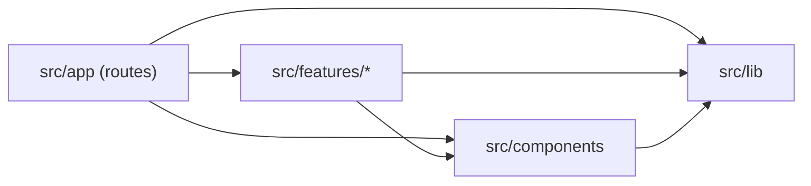

# Struktur Kode (Feature-Based)

Terkait: [[03 Arsitektur Sistem]] · [[13 Implementation Plan]] · `AGENTS.md` §8

> [!important] Ringkas
> Kode dikelompokkan **per fitur** di `src/features/`. Kode yang dipakai lebih dari satu fitur ada di `src/lib/` (logika & infrastruktur) atau `src/components/` (UI). `src/app/` hanya berisi route yang tipis.
> Struktur ini **menggantikan path di Peta File [[13 Implementation Plan]]**. Pakai tabel §6 untuk menerjemahkan path plan.

## 1. Kenapa feature-based

- **Tim 4 orang paralel:** tiap fitur punya folder sendiri, jadi Ukon (UI), Bagus (AI), dan Rhein (backend) jarang mengedit file yang sama → konflik merge kecil.
- **Satu PR = satu folder fitur:** cocok dengan alur branch `feature/<nama-fitur>`.
- **Mudah dipotong:** fitur Should/Could (F8, F4) bisa dihapus atau ditunda tanpa menyentuh fitur lain.

Disesuaikan dari pola feature-based umum, dengan perbedaan karena SiagaKU adalah **monolit Next.js**, bukan frontend yang memanggil backend terpisah:

| Pola umum | Di SiagaKU |
|---|---|
| `lib/api-client.ts` (axios) + `config/api.ts` (base URL) | **Tidak dipakai.** Server Component memanggil fungsi `server/` langsung; client memakai `fetch` ke route handler sendiri. |
| `services/` global | Service ada di `features/<f>/server/`. Yang dipakai lintas fitur masuk `src/lib/`. |
| `store/` (state management) | **Tidak dipakai.** Data dari Server Component; state lokal di `localStorage`. |
| `hooks/` global | Hanya jika benar-benar dipakai ≥ 2 fitur. Default: `features/<f>/hooks/`. |

## 2. Struktur folder

```
src/
├── app/                          # ROUTES SAJA (tipis)
│   ├── (site)/                   # halaman publik, segmen URL berbahasa Indonesia
│   │   ├── layout.tsx
│   │   ├── page.tsx              # landing
│   │   ├── peta/page.tsx
│   │   ├── wilayah/[slug]/page.tsx
│   │   ├── rencana/page.tsx, rencana/[slug]/page.tsx
│   │   ├── tanya/page.tsx
│   │   ├── peringatan/page.tsx
│   │   ├── lapor/page.tsx, laporan/page.tsx
│   │   └── tentang/page.tsx
│   ├── api/                      # route handler, path berbahasa Inggris
│   │   ├── districts/route.ts
│   │   ├── risk/[id]/route.ts, risk/[id]/explanation/route.ts
│   │   ├── chat/route.ts
│   │   ├── plans/route.ts, plans/[slug]/route.ts
│   │   ├── subdistricts/route.ts, early-warning/[code]/route.ts
│   │   ├── push/{subscribe,unsubscribe,test}/route.ts
│   │   ├── reports/route.ts, reports/upload-url/route.ts
│   │   ├── cron/early-warning/route.ts
│   │   └── health/route.ts
│   ├── manifest.ts
│   └── globals.css
│
├── components/                   # UI BERSAMA lintas fitur
│   ├── ui/                       # shadcn/ui (button.tsx, dialog.tsx, …)
│   ├── layout/                   # header, footer, emergency-button, emergency-dialog
│   ├── map/risk-map.tsx          # dipakai risk & report
│   └── risk-badge.tsx            # dipakai risk, plan, early-warning
│
├── lib/                          # INTI BERSAMA (tanpa UI)
│   ├── env.ts, utils.ts
│   ├── http.ts, rate-limit.ts, geo.ts
│   ├── db/client.ts
│   ├── data/cache.ts, bmkg.ts, open-meteo.ts
│   ├── risk/level.ts, score.ts, vulnerability.ts
│   └── ai/providers.ts, router.ts, log.ts
│
└── features/                     # MODUL PER FITUR
    ├── risk/                     # F1 Cek Risiko Wilayah (+ F5 kartu iklim statis)
    ├── plan/                     # F2 Rencana Siaga
    ├── chat/                     # F3 Tanya SiagaKU (+ RAG)
    ├── early-warning/            # F8 Peringatan Dini
    └── report/                   # F4 Lapor Banjir
```

### Anatomi satu fitur

```
features/plan/
├── components/          # komponen UI khusus fitur ('use client' bila perlu)
│   ├── plan-wizard.tsx
│   └── plan-view.tsx
├── hooks/               # opsional, hook khusus fitur
├── server/              # HANYA server: DB, AI, API eksternal. Baris pertama: import 'server-only';
│   ├── generate-plan.ts
│   ├── plan-prompt.ts
│   └── plans-repository.ts
├── schemas.ts           # zod schema (request, output AI)
├── types.ts             # tipe TypeScript fitur
└── safe-points.ts       # logika murni (boleh dipakai client & server)
```

Folder yang tidak dibutuhkan **tidak dibuat**. Fitur kecil boleh hanya punya `components/` dan `server/`.

## 3. Aturan dependensi



1. **`app/` tipis.** Page memanggil fungsi dari `features/<f>/server/` lalu merender komponen. Route handler: parse & validasi input (zod) → rate limit → panggil service → `Response`. Tidak ada query DB atau prompt AI langsung di `app/`.
2. **Fitur tidak boleh meng-import fitur lain.** Jika fitur B butuh sesuatu dari fitur A, pindahkan bagian itu ke `src/lib/` (logika) atau `src/components/` (UI) dalam PR yang sama.
3. **`lib/` dan `components/` tidak boleh meng-import `features/`.**
4. **Komponen tidak memanggil DB/AI langsung.** Server Component memanggil `features/<f>/server/*`; client component memanggil route handler lewat `fetch` (atau `useChat` dari AI SDK untuk chat).
5. **Batas server/client tegas.** Semua file di `server/` dan `src/lib/db/` diawali `import 'server-only';`. Logika murni (tanpa I/O) diletakkan di luar `server/` agar bisa diuji dan dipakai client.
6. **Tanpa barrel `index.ts`.** Import path file langsung (`@/features/plan/server/generate-plan`). Barrel di Next.js mudah mencampur kode server ke bundle client.

## 4. Penamaan

- Nama file & folder: **kebab-case, bahasa Inggris** (`risk-badge.tsx`, `generate-plan.ts`, `early-warning/`). Komponen React diekspor **PascalCase** (`export function RiskBadge`).
- Segmen URL halaman di `app/(site)/` tetap bahasa Indonesia (`/wilayah`, `/rencana`); path API bahasa Inggris (`/api/plans`).
- Identifier dari plan diterjemahkan memakai glosarium `AGENTS.md` §3.

## 5. Test

`tests/` meniru struktur `src/`:

```
tests/
├── lib/            # risk.test.ts, weather.test.ts, cache.test.ts, ai-router.test.ts, …
├── features/
│   ├── plan/       # plan.test.ts, api-plans.test.ts
│   └── chat/       # emergency.test.ts, api-chat.test.ts
├── fixtures/
└── eval/
```

Test route handler diletakkan di folder fitur yang dilayaninya (mis. `tests/features/chat/api-chat.test.ts`).

## 6. Pemetaan path Plan → struktur baru

T1–T6 sudah sesuai (inti di `src/lib/`), tidak ada yang dipindah. Mulai T7 pakai kolom kanan.

| Task | Path di plan | Path baru |
|---|---|---|
| T4 | `src/lib/geo.ts`, `scripts/*`, `data/*.csv` | tetap |
| T5 | `src/lib/ai/{providers,router,log}.ts` | tetap |
| T6 | `src/lib/rate-limit.ts`, `src/lib/http.ts` | tetap |
| T7 | `src/lib/risk/service.ts` | `src/features/risk/server/risk-service.ts` |
| T7 | `src/lib/ai/schemas.ts` (`Penjelasan`) | `src/features/risk/schemas.ts` (`ExplanationSchema`) |
| T7 | `src/lib/ai/prompts/penjelasan.ts`, `src/lib/ai/penjelasan.ts` | `src/features/risk/server/explanation-prompt.ts`, `explanation.ts` |
| T7 | `app/api/kecamatan`, `app/api/risiko/[id]`, `…/penjelasan` | `app/api/districts`, `app/api/risk/[id]`, `app/api/risk/[id]/explanation` |
| T8 | `components/layout/{Header,Footer,EmergencyButton,EmergencyDialog}.tsx` | `src/components/layout/{header,footer,emergency-button,emergency-dialog}.tsx` |
| T8 | `components/map/RiskMap.tsx`, `components/risk/RiskBadge.tsx` | `src/components/map/risk-map.tsx`, `src/components/risk-badge.tsx` (bersama) |
| T8 | `components/search/KecamatanSearch.tsx` | `src/features/risk/components/district-search.tsx` |
| T8 | `components/risk/{RiskGauge,ScoreBreakdown,WeatherStrip,FloodHistory,SafePoints,AiExplanation}.tsx` | `src/features/risk/components/{risk-gauge,score-breakdown,weather-strip,flood-history,safe-points,ai-explanation}.tsx` |
| T9 | `src/lib/rag/{chunk,embed,retrieve}.ts` | `src/features/chat/server/rag/{chunk,embed,retrieve}.ts` |
| T9 | `scripts/ingest-dokumen.ts` | `scripts/ingest-documents.ts` |
| T10 | `src/lib/safety/emergency.ts` | `src/features/chat/detect-emergency.ts` (murni) |
| T10 | `src/lib/ai/prompts/chat.ts` | `src/features/chat/server/chat-prompt.ts` |
| T10 | `components/chat/*` | `src/features/chat/components/{chat-panel,chat-widget,message-bubble,source-list,emergency-card,suggestion-chips}.tsx` |
| T11 | `src/lib/rencana/schema.ts` | `src/features/plan/schemas.ts` |
| T11 | `src/lib/rencana/{titik-aman,rencana-dasar}.ts` | `src/features/plan/{safe-points,basic-plan}.ts` (murni) |
| T11 | `src/lib/rencana/generate.ts`, `src/lib/ai/prompts/rencana.ts` | `src/features/plan/server/{generate-plan,plan-prompt}.ts` |
| T11 | `app/api/rencana`, `app/api/rencana/[slug]` | `app/api/plans`, `app/api/plans/[slug]` |
| T11 | `components/plan/*` | `src/features/plan/components/{plan-wizard,step-area,step-members,step-conditions,plan-view,checklist,safe-point-list,share-actions}.tsx` |
| T12 | `app/api/health`, `vercel.json`, `app/(site)/tentang` | tetap |
| T13 | `scripts/eval.ts`, `tests/eval/*` | tetap |
| T14 | `src/lib/peringatan/evaluate.ts` | `src/features/early-warning/evaluate.ts` (murni) |
| T14 | `src/lib/peringatan/{notify,run}.ts` | `src/features/early-warning/server/{notify,run}.ts` |
| T14 | `src/lib/push-client.ts` | `src/features/early-warning/push-client.ts` |
| T14 | `app/api/kelurahan`, `app/api/peringatan/[kode]`, `app/api/cron/peringatan` | `app/api/subdistricts`, `app/api/early-warning/[code]`, `app/api/cron/early-warning` |
| T14 | `components/alert/{AlertBanner,WatchButton,PushControls,IosInstallHint}.tsx` | `src/features/early-warning/components/{alert-banner,watch-button,push-controls,ios-install-hint}.tsx` |
| T14 | `app/manifest.ts`, `public/sw.js`, `.github/workflows/peringatan.yml` | tetap (workflow: `early-warning.yml`) |
| T15 | `src/lib/laporan/{schema,analyze}.ts`, `src/lib/ai/prompts/vision.ts` | `src/features/report/schemas.ts`, `src/features/report/server/{analyze-report,vision-prompt}.ts` |
| T15 | `src/lib/image/compress.ts` | `src/features/report/compress-image.ts` (client) |
| T15 | `app/api/laporan`, `app/api/laporan/upload-url` | `app/api/reports`, `app/api/reports/upload-url` |
| T15 | `components/report/*` | `src/features/report/components/*` |
| T16 | `components/risk/ClimateCard.tsx` | `src/features/risk/components/climate-card.tsx` |
| T17 | `README.md`, `CREDITS.md`, `scripts/smoke.ts` | tetap |

## 7. Contoh alur: halaman wilayah

```
app/(site)/wilayah/[slug]/page.tsx            (Server Component)
  └─ getRiskDetail(slug)                      features/risk/server/risk-service.ts
       ├─ supabaseServer()                    lib/db/client.ts
       ├─ getMaxRainfall3Days(...)            lib/data/open-meteo.ts  → getOrSet (lib/data/cache.ts)
       ├─ getBmkgForecast(adm4)               lib/data/bmkg.ts
       └─ calculateRiskScore(...)             lib/risk/score.ts
  └─ <RiskBadge/> <WeatherStrip/> …           components/risk-badge.tsx, features/risk/components/*
  └─ <AiExplanation districtId/>              client → fetch /api/risk/[id]/explanation
                                                 └─ app/api/risk/[id]/explanation/route.ts
                                                      └─ getExplanation(...)  features/risk/server/explanation.ts
                                                           └─ withFallback('explanation', …)  lib/ai/router.ts
```

## 8. Kepemilikan folder

| Folder | Pemilik utama |
|---|---|
| `src/lib/` (db, data, risk, http, rate-limit), `app/api/*` | Rhein |
| `src/lib/ai/`, `features/*/server/` bagian AI (prompt, generate, rag) | Bagus |
| `src/components/`, `features/*/components/`, `app/(site)/*` | Ukon |
| `data/`, `docs/`, `tests/eval/` | Syaki |

Mengubah folder milik orang lain boleh, asal disebut di deskripsi PR dan pemiliknya ikut review.

## 9. Checklist menambah fitur baru

1. Branch `feature/<nama-fitur>` dari `dev`.
2. Buat `src/features/<nama-fitur>/` dengan folder yang dibutuhkan saja.
3. Route di `app/` tetap tipis; logika di `features/<f>/server/`.
4. Butuh sesuatu dari fitur lain? Pindahkan ke `lib/` atau `components/`, jangan import silang.
5. Test di `tests/features/<nama-fitur>/`.
6. Library baru → `CREDITS.md`.
